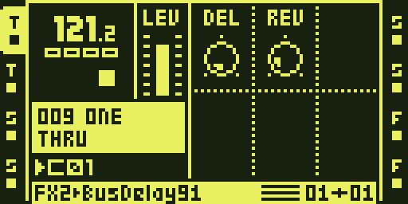
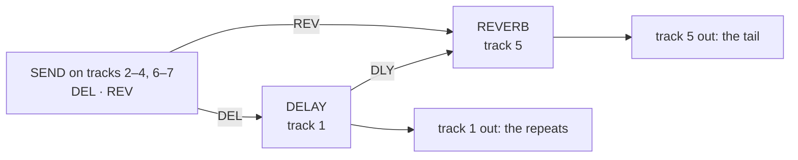

# Octabam Bus



*Bus Delay, the bus effect on FX1*

Octabam Bus adds the core features, a **delay and reverb bus** with a send
from every track, three new FX1 effects, ten stock effects on FX1 and the extra ColdFire modules of [Octabam](remix-octabam.md) (OCTA303, MORPH, REC THRESHOLD, BUFFER SAVER, COPY PROJECT, EUCLID FILL, TRACK PATTERNS) to Octatrack OS 1.40C. The USB
module's defaults here are TRACKS PRE, MAIN and CUE on, MASTER off, IN off,
MIDI on. They are changed on the unit in PROJ > BRAIN > SETTINGS and take
effect at the next boot; see [USB](reference/modules/usb.md).

## The Bus

Every track's FX2 slot takes part in one delay-and-reverb chain. Tracks 1
and 5 host the two engines; every other track has a SEND with two knobs,
DEL and REV, that set how much of the track goes to each. The delay's
repeats also feed the reverb (the reverb's DLY knob). Each engine's wet
signal comes out on the track that hosts it.

!!! warning "Required track setup"
    Set tracks 1 and 5 to THRU with no trigs of their own. This is the only
    bus setup tested so far. Sounds programmed on track 1 made the delay pop
    and click; the cause is still open. Track 5 with a sample machine or
    trigs has not been tested. See the
    [failure register](https://github.com/sambanks/octabam/blob/main/docs/contributing/FAILURE_MODES.md).



| track | FX2 | knobs |
|---|---|---|
| 1 | [DELAY](reference/modules/busdelay.md) (locked) | page 1: DEL · REV · FDBK · TONE · PING · WET; page 2: MODE · SCTR · DENS · SIZE · PTCH · TIME |
| 5 | [REVERB](reference/modules/busverb.md) (locked) | page 1: DEL · REV · SIZE · SHMR · SHFT · WET; page 2: MODE · TONE · DIFF · GATE · DLY · TIME |
| 2–4, 6–7 | [SEND](reference/modules/send.md) | DEL · REV |
| 8 (master) | stock [DELAY](reference/modules/delay.md) | stock's, for its beat repeat |

A new part is born wired this way (the RIG HOSTS module: T1 FX2 = BusDelay,
T5 = BusVerb, T8 = the stock DELAY, the rest SEND). The delay follows the
project tempo (TEMPO SYNC), and the TEMPO window lists and edits both
engines' knobs (TEMPO BUS). Turning a MODE on the panel re-defaults the
knobs around it (MODE DEFAULTS). The FX2 chooser cannot change a track's
effect (FX2 LOCK).

## FX1

| effect | in place of | modes |
|---|---|---|
| [SPECTRUM](reference/modules/spectrum.md) | [FILTER](reference/modules/filter.md) | LADR · SEM · ISO · VOWL |
| [CHARACTER](reference/modules/character.md) | [LO-FI](reference/modules/lofi.md) | SAT: TAPE · TUBE · INFL |
| [MODULATION](reference/modules/modulation.md) | [CHORUS](reference/modules/chorus.md) | JUNO · DIM · FLNG · COMB · PHSR |

The FX1 chooser lists NONE and these three. The 13 stock effects not listed
give up their DSP code to the bus.

## Prepare an existing project

For an existing project, assign the bus effects and update its saved effect
values before playing. Replace `<card>/<set>/<project>` with the project's
path on the CF card:

```bash
python3 tools/hw/ot_project.py host "<card>/<set>/<project>"
python3 tools/hw/ot_project.py stamp-defaults "<card>/<set>/<project>" octabam-bus
```

`host` assigns the delay to track 1, the reverb to track 5, SEND to the
other bus tracks, and stock DELAY to track 8. `stamp-defaults` updates the
saved effect values for this remix. A project created on the unit after the
flash needs neither command.

## Build and install

[Build and Install](web-builder.md) patches your copy of OS 1.40C into this
remix in the browser and gives you the files to install.

After installation, SYSTEM STATUS → OS VERSION shows `OCTABAM` and the build
tag.
For stock OS recovery, follow [Safety and recovery](safety.md).

If the unit misbehaves, the failure register lists what has gone wrong and
why: https://github.com/sambanks/octabam/blob/main/docs/contributing/FAILURE_MODES.md

## The modules

Every module in the image, credited to its author:

??? note "Full module list and authors"

    --8<-- "reference/_remix-octabam-bus.md"

## Memory use

| Resource | Stock OS | Octabam Bus |
|---|---|---|
| Sample and recorder memory | 14,602 pages | 12,895 pages (platform reserve) |
| DSP code in the window | — | the servers, SEND, SPECTRUM, CHARACTER, MODULATION and LOAD METER |

## Where it has run

Port gates only: `make check REMIX=octabam-bus` and the reach round. The seven extra ColdFire modules have not run beside the bus on a unit. The previous
definition of this remix ran on an MKII (owner report, 16 Oct 2026). The servers and
stations running from the shared window, and the stock effects beside them, have not
run on a unit.
