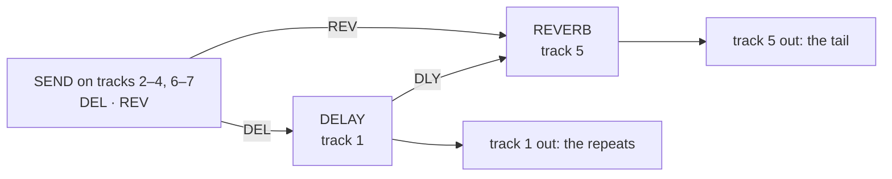

# octabam-bus

A remix of Octatrack OS 1.40C, built from your own copy of it, that adds a
**delay and reverb bus** with a send from every track, three new FX1
effects, and the core modules. It is bottleservice's bus with the core set
added; the USB module uses LAYOUT MAIN CUE and INPUTS OFF here. These USB
settings take effect when the image is built; on-device configuration is
not implemented in this version.

## The bus

Every track's FX2 slot takes part in one delay-and-reverb chain. Tracks 1
and 5 host the two engines; every other track has a SEND with two knobs,
DEL and REV, that set how much of the track goes to each. The delay's
repeats also feed the reverb (the reverb's DLY knob). Each engine's wet
signal comes out on the track that hosts it.

!!! warning "Tracks 1 and 5 must be THRU tracks with no trigs of their own"
    That is the only setup the bus has been tested in. Sounds programmed on
    track 1 made the delay pop and click (reported 29 Sep 2026, cause open:
    the failure register). Track 5 with a sample machine or trigs has not
    been tested.



| track | FX2 | knobs |
|---|---|---|
| 1 | [DELAY](reference/modules/busdelay.md) (locked) | page 1: DEL · REV · FDBK · TONE · PING · WET; page 2: MODE · SCTR · DENS · SIZE · PTCH · TIME |
| 5 | [REVERB](reference/modules/busverb.md) (locked) | page 1: DEL · REV · SIZE · SHMR · SHFT · WET; page 2: MODE · TONE · DIFF · GATE · DLY · TIME |
| 2–4, 6–7 | [SEND](reference/modules/send.md) | DEL · REV |
| 8 (master) | stock [DELAY](reference/modules/delay.md) | stock's, for its beat repeat |

A new part is born wired this way (the RIG HOSTS module: T1 FX2 = BusDelay,
T5 = BusVerb, T8 = the stock DELAY, the rest SEND). The delay follows the
project tempo (TEMPO SYNC), and the TEMPO window lists and edits both
engines' knobs (TEMPO BUS). Turning a MODE on the panel re-defaults the
knobs around it (MODE DEFAULTS). The FX2 chooser cannot change a track's
effect (FX2 LOCK).

## FX1

| effect | in place of | modes |
|---|---|---|
| [SPECTRUM](reference/modules/spectrum.md) | [FILTER](reference/modules/filter.md) | LADR · SEM · ISO · VOWL |
| [CHARACTER](reference/modules/character.md) | [LO-FI](reference/modules/lofi.md) | SAT: TAPE · TUBE · INFL |
| [MODULATION](reference/modules/modulation.md) | [CHORUS](reference/modules/chorus.md) | JUNO · DIM · FLNG · COMB · PHSR |

The FX1 chooser lists NONE and these three. The 13 stock effects not listed
give up their DSP code to the bus.

## The modules

Every module in the image, credited to its author:

--8<-- "reference/_remix-octabam-bus.md"

## What it costs

| | stock | octabam-bus |
|---|---|---|
| sample and recorder memory | 14,602 pages | 12,895 pages (the platform reserve) |
| DSP words free, payload A / B | | 44 / 605 |

## Where it has run

Port gates only: `make check REMIX=octabam-bus` and the reach round. Not on
a unit. bottleservice, the same bus without the core additions, ran on Sam's
MKII (images A0–A6; the changelog).

## How to flash

The [build and flash guide](build-flash.md) has every step, from what to
install to the way back to stock. For this remix:

1. **Build.** Pick a build number; it becomes the OS version the unit shows.

   ```bash
   make image REMIX=octabam-bus BUILD=91         # -> out/OCTATRACK_OCTABAM91.bin
   ```

2. **Back up the card.** KITS writes `kits.work` into each project it loads.
3. **Old projects.** For a project made before this remix, on the card:

   ```bash
   python3 tools/hw/ot_project.py host "<card>/<set>/<project>"
   python3 tools/hw/ot_project.py stamp-defaults "<card>/<set>/<project>" octabam-bus
   ```

   `host` wires the delay to track 1, the reverb to track 5 and SEND
   elsewhere. A project made on the unit after the flash needs neither.
4. **Flash from the card**, then power-cycle once more. SYSTEM STATUS → OS
   VERSION reads `OCTABAM91`.
5. **Back to stock:** [Safety and recovery](safety.md).

If the unit misbehaves, the failure register lists what has gone wrong and
why: https://github.com/sambanks/octabam/blob/main/docs/contributing/FAILURE_MODES.md
