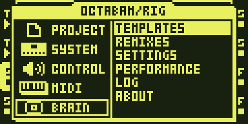

# Octabam v0.5

*BRAIN in the main menu, added by Octabam*

Octabam adds the core features to Octatrack OS 1.40C, four effects and a machine. All 14
stock effects and both effect menus stay as stock has them, with stock LO-FI's AMF knob
fixed. The [Octabam Manual](reference/manual/index.md)
has a page for every feature, shared with the other two remixes.

!!! warning "Known fault: DARK REV while MODULATION is loaded"
    The DSP can stop when a program change puts DARK REV on several tracks while MODULATION is
    loaded (in use on a track, or in the 10 s after the last track stops using it), followed by
    PLAY. The sound stops; the panel and USB still answer; a power-cycle clears it. The cause is
    not known. Avoid DARK REV on many tracks in a song that uses MODULATION.

## The effects

SPECTRUM, CHARACTER and MODULATION are on FX1 and FX2, and SHATTER on FX2, beside the stock
effects. COMPRESSOR gains a side-chain: on page 2, KEY picks the track that drives it
([side-chain compressor](reference/manual/effects/sidechain-compressor.md)).

| Effect | What it is |
|---|---|
| [SPECTRUM](reference/manual/effects/spectrum.md) | filter: Moog ladder, SEM, isolator, formants |
| [CHARACTER](reference/manual/effects/character.md) | fold, saturation, tilt, compressor, width |
| [MODULATION](reference/manual/effects/modulation.md) | Juno, Dimension, flanger, phaser, comb |
| [SHATTER](reference/manual/effects/shatter.md) | fold, clip, bit and sample-rate crush, chaotic feedback |

Each is loaded into the audio processor only while a track uses it. Until the code arrives,
about 25 ms after you choose the effect, it passes the audio through; a pattern change that
puts one on all eight tracks, or takes it off them, leaves about 0.34 s of silence at the
switch ([effect loader](reference/manual/inside.md#effect-loader-sender)). A stock reverb and a
loaded effect cannot share the FX2 memory they both use: the chooser refuses the second with
a message.

## What else you get

- [BRAIN](reference/manual/brain/index.md): a **PROJ → BRAIN** menu with templates, shared
  settings, effect defaults, performance views and a switcher that boots another image from
  the card.
- [Kits](reference/manual/parts/kits.md): 255 Kits per project; each pattern plays the Kit
  assigned to it.
- [Page 2 parameter locks](reference/manual/parts/plocks-p2.md) and
  [scene locks](reference/manual/parts/scenes-p2.md): control both effect pages, with
  [CC map](reference/manual/midi-usb/cc-map.md) in and
  [CC feedback](reference/manual/midi-usb/cc-feedback.md) out, so a controller's encoders
  follow the unit.
- [MIDI scenes](reference/manual/parts/midi-scenes.md): scene locks for the eight MIDI tracks.
- [USB](reference/manual/midi-usb/usb.md): MIDI both ways, plus audio to a computer: the 16
  track channels, MAIN and CUE by default.
- [SCOPE](reference/manual/utilities/scope.md) (**[DOWN]** + **[TEMPO]**) and
  [TUNER](reference/manual/utilities/tuner.md) (**[UP]** + **[TEMPO]**): full-screen track
  audio and note tuning.
- [OCTA-303](reference/manual/machines/octa303.md): a TB-303 voice as a machine.
- [WAVE](reference/manual/machines/wavecf.md): a 4-voice wavetable voice with chords as a
  machine; a Part holds two machines of either kind.
- [SEQ](reference/manual/sequencer/seq.md) (**[TRACK]** + **[PAGE]**): Euclidean rhythms,
  lock rhythms and generated melodies for a track.
- [Pattern mute](reference/manual/sequencer/pattern-mute.md): double-press FUNC to mute
  tracks per pattern as well as globally.
- [Scales](reference/manual/midi-usb/scales.md) and
  [Chords factory](reference/manual/midi-usb/chords.md): 52 scales for a MIDI track's KEY
  and the scale quantizer, and chord progressions for a MIDI track.
- [Slow LFO](reference/manual/sequencer/slow-lfo.md) (LFO MULT down to 1/8X) and
  [bar LED](reference/manual/sequencer/bar-led.md) (the tempo LED green on the 1).
- [Screen](reference/manual/midi-usb/screen.md): screenshots over MIDI, with Elektron's
  screenshot request.
- More sequencing and recording features, utilities and
  [fixes to stock behaviour](reference/manual/fixes.md): the manual's
  [table of what each remix has](reference/manual/index.md#which-remix-has-what) lists them all.

## Install

1. **Back up the card.** KITS writes `kits.work` into each project it loads.
2. [Build and Install](web-builder.md) patches your copy of OS 1.40C in the
   browser and gives you the files to install.
3. Follow [Install the image](web-builder.md#install-the-image) and confirm that
   SYSTEM STATUS → OS VERSION shows `OCTABAM` and the build number.
4. A project made on the unit after installing needs no preparation.
5. To restore stock OS, follow [Safety and Recovery](safety.md).

## Everything in the image

??? note "Full list of features and authors"

    --8<-- "reference/_remix-octabam.md"
