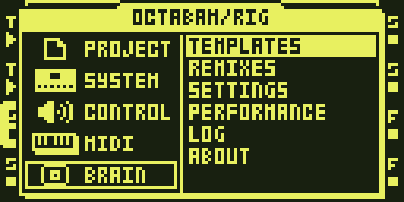

# Octabam



*BRAIN in the main menu, added by Octabam*

Octabam adds the core features to Octatrack OS 1.40C and five effects. All 14
stock effects and both effect menus stay as stock has them, with stock LO-FI's
AMF knob fixed (the LOFI AMF FIX module) and a side-chain on COMPRESSOR's page 2
([SIDECHAIN_COMPRESSOR](usage/sidechain-compressor.md)). [Octabam Bus](remix-bus.md) adds the
delay and reverb bus to the same set.

## The effects

SPECTRUM, CHARACTER and MODULATION are on FX1 and FX2. TRANSIENT is on FX2.
Their DSP code runs from the shared P window beside the stock effects, on
free effect ids.

| Effect | FX1 | FX2 | Description |
|---|---|---|---|
| [SPECTRUM](reference/modules/spectrum.md) | ✓ | ✓ | filter: Moog ladder, SEM, Capacitor2, formants |
| [CHARACTER](reference/modules/character.md) | ✓ | ✓ | fold, saturation, tilt, compressor, width |
| [MODULATION](reference/modules/modulation.md) | ✓ | ✓ | Juno, Dimension, flanger, phaser, comb |
| [TRANSIENT](reference/modules/transient.md) | — | ✓ | transient shaper (Ignorato) |

COMPRESSOR is stock COMPRESSOR with a side-chain: on page 2, KEY picks the track
that drives it (see [SIDECHAIN_COMPRESSOR](usage/sidechain-compressor.md)). Its
side-chain code is loaded while a track uses COMPRESSOR, like the four effects above;
until it is, and while DARK REV or another loaded effect holds the top of T4's FX2
block, COMPRESSOR works as stock and the screen says `SC KEY OFF`.

The stations have their SLOTS build setting at FX1+FX2. CHARACTER's KEY = T1
needs a BusDelay host, so in this remix it keys on the track's own input. A MODE
turned on the panel re-defaults the knobs around it (the MODE DEFAULTS module).

## Included features

- [BRAIN](brain.md): templates, settings, defaults, and remix switching.
- [KITS](reference/modules/kits.md): save and recall a Kit for each pattern.
- [Page 2 locks](reference/modules/plocks-p2.md) and
  [scene locks](reference/modules/scenes-p2.md): control both effect pages.
- [MIDI scenes](reference/modules/midi-scenes.md), CC mapping, and CC feedback.
- [USB](reference/modules/usb.md): MIDI input and output, plus audio to a computer: the 16 track channels, MAIN and CUE by default.
- [PATTERN MUTE](reference/modules/pattern-mute.md): double-press FUNC to mute tracks per pattern as well as
  globally, as on the Digitakt II.
- Recorder, sequencing, mute, and storage fixes listed below.

## Build and install

1. **Back up the card.** KITS writes `kits.work` into each project it loads.
2. [Build and Install](web-builder.md) patches your copy of OS 1.40C into this
   remix in the browser and gives you the files to install.
3. **Old projects.** For a project made before this remix, on the card:

   ```bash
   python3 tools/hw/ot_project.py stamp-defaults "<card>/<set>/<project>" octabam
   ```

   A project made on the unit after the flash needs no stamp.
4. Follow [Install the image](web-builder.md#install-the-image) and confirm
   that SYSTEM STATUS → OS VERSION shows `OCTABAM` and the build tag.
5. To restore stock OS, follow [Safety and recovery](safety.md).

If the unit misbehaves, the failure register lists what has gone wrong and
why: https://github.com/sambanks/octabam/blob/main/docs/contributing/FAILURE_MODES.md

## Module list

Every module in the image, credited to its author:

??? note "Full module list and authors"

    --8<-- "reference/_remix-octabam.md"

USB combines MIDI, audio output, audio input and the input crossbar in one
module. Its settings (TRACKS, MAIN, CUE, MASTER, MIDI) are changed on the
unit in PROJ > BRAIN > SETTINGS and take effect at the next boot; IN is OFF
by default. See [USB](reference/modules/usb.md).

## Memory use

| Resource | Stock OS | Octabam |
|---|---|---|
| Sample and recorder memory | 14,602 pages | 12,895 pages (platform reserve) |

## Where it has run

Port gates only: `make check REMIX=octabam` and the reach round. The window's
wait-state cost and the effects running from the window have not been measured
on a unit.
