# `drummer` — DRUMMER (français)

Auteur : [djib](https://github.com/Djibdjib). Rangée de machine reprise
d'ANALOG BD ([repeat98](https://github.com/repeat98)) ; fenêtre KIT dessinée
comme les sélecteurs de CHORDS et SCALES ; `drummer.work` enregistré par
[STORE](../store/README.md).

Traduction du guide d'utilisation du [README](README.md). La partie
[Reference](README.md#reference) (mesures, détails du firmware) reste en
anglais.

**Sommaire :** [Ce que fait DRUMMER](#ce-que-fait-drummer) ·
[Démarrage rapide](#démarrage-rapide) · [Les pages](#les-pages) ·
[Comment le kit est fait](#comment-le-kit-est-fait) ·
[REDRUM](#redrum--ta-boucle-comme-groove) · [Configurations](#configurations) ·
[Tuto 1 : un batteur à partir d'une boucle](#tuto-1--un-batteur-à-partir-dune-boucle-slicée) ·
[Tuto 2 : REDRUM](#tuto-2--redrum-re-jouer-ton-break)

## Ce que fait DRUMMER

DRUMMER transforme une piste FLEX qui contient un **sample de batterie
découpé en slices** en batteur. Tu lui donnes une boucle (ou un kit de
coups isolés) découpée en slices ; il range chaque slice dans un élément de
batterie et les joue, en direct, dans le style que tu choisis. Rien n'est
écrit dans le pattern : à chaque pas, DRUMMER décide quelle slice joue, à
quel volume, un peu en avance ou en retard, d'après quelques potentiomètres.
Tourne-les pendant qu'il joue et le batteur suit : plus simple ou plus
chargé, plus carré ou plus lâche, avec des fills, des ghost notes, des
breaks au crossfader.

Il joue de deux façons :

- **Un style** (REDRUM OFF). DRUMMER joue l'un des 29 grooves écrits
  (breakbeat, funk, house, jungle, dub, afrobeat, bossa, techno, trap...)
  avec les sons de ton kit.
- **REDRUM** (ON). DRUMMER joue **le groove de ta propre boucle**, slice par
  slice, et les mêmes potentiomètres le déforment : rejouer le break tel
  quel, puis l'alléger, échanger ses coups, ajouter ghosts, fills et breaks.

La piste reste une piste FLEX : son sample, ses slices, AMP, LFO et effets
sont ceux de FLEX, et un projet ouvert sur un Octatrack d'origine y trouve
une simple piste FLEX.

## Où le trouver

DRUMMER est dans le remix de test `drummer`. Il a besoin de STORE (les kits
sont enregistrés avec le projet) et de PAGES (KIT BALANCE et NEXT). Les
huit pistes peuvent être des pistes DRUMMER, chacune avec son kit.

## Démarrage rapide

1. Charge une boucle de batterie sur une piste FLEX et **découpe-la** dans
   l'éditeur audio (grille, transitoires ou à la main : DRUMMER lit les
   slices, il ne les déplace jamais). Un coup par slice, c'est l'idéal.
2. **FUNC + SRC** ouvre la liste des machines. Descends : **DRUMMER** est
   la dernière ligne. **YES** fait de la piste une piste DRUMMER et affiche
   ses réglages CONFIG (RIGHT sur la ligne choisit d'abord un autre sample).

   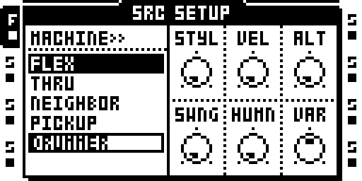

3. Ferme avec **NO** : DRUMMER propose de faire un kit. **YES** : il écoute
   chaque slice et la range (kick, caisse claire, charleys...) ; une
   notification dit combien de slices il a rangées. **NO** laisse le kit
   vide ; seuls les trigs de la piste jouent alors.

   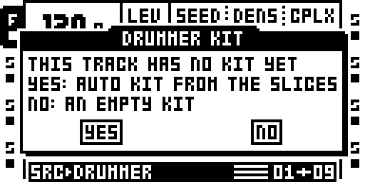

   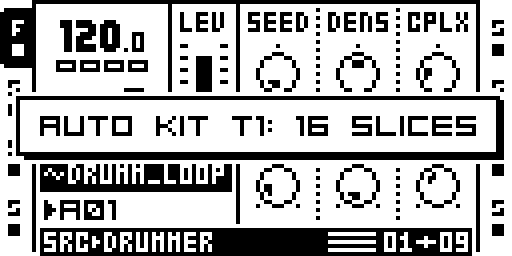

4. **PLAY**. La piste joue le style affiché sur CONFIG (BRKB, un
   breakbeat, au départ). Tourne les potentiomètres.

Pas besoin d'un seul trig sur la piste. Un trig que tu poses joue quand
même : c'est un accent (sur un pas vide, un kick sur le temps, sinon une
caisse claire).

## Les pages

Une piste DRUMMER a cinq écrans à elle. **SRC** fait défiler les trois
premiers (LIVE, KIT BALANCE, NEXT) ; **FUNC + SRC** ouvre CONFIG ; **une
touche de trig maintenue + BANK** ouvre la fenêtre KIT.

| écran | ouverture | contenu |
|---|---|---|
| LIVE | SRC | les six potentiomètres de jeu : SEED DENS CPLX ORN BRK GHST |
| KIT BALANCE | SRC à nouveau | combien joue chaque groupe d'éléments |
| NEXT | SRC une troisième fois | des ordres sur le temps : arrêter, reprendre, un fill, un style, un break |
| CONFIG | FUNC + SRC | le style et le feeling : STYL VEL ALT SWNG HUMN VAR |
| Fenêtre KIT | maintenir un trig, appuyer sur BANK | le kit : l'élément, le niveau et le calage de chaque slice ; les réglages de la piste et REDRUM ; les fills |

### LIVE : les potentiomètres de jeu

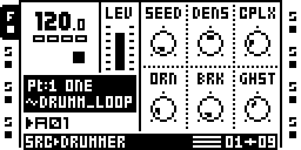

| potard | 0 | 64 | 127 |
|---|---|---|---|
| **SEED** | le style tel qu'écrit | une variation | la variation la plus éloignée |
| **DENS** | presque rien : l'ossature seule | le style tel qu'écrit | plus chargé : des coups en plus, tirés de la version complexe |
| **CPLX** | la version BASIC du style | STANDARD | COMPLEX |
| **ORN** | pas d'ornements | flas sur les caisses claires fortes, roulements en fin de fill | ras, charleys doublés et triplés en plus |
| **BRK** | le groove | (voir plus bas) | bégaiements et répétitions |
| **GHST** | pas de ghost notes | quelques-unes | beaucoup de caisses claires douces autour du backbeat |

**SEED** choisit une variation du style : `TBL` à 0, c'est le style écrit ;
ensuite huit bandes de seize variations, affichées `bande:variation`
(`1:01` ... `8:15`). La bande dit jusqu'où va la variation (la bande 1
touche environ une case sur huit, la bande 8 plus de la moitié), et une
variation garde son caractère d'une bande à l'autre, seulement plus
marqué. Le kick sur le 1 et les caisses claires sur le 2 et le 4 ne bougent
jamais. Le même SEED rejoue toujours la même performance depuis PLAY.

**CPLX** parcourt les trois niveaux écrits du style, BASIC, STANDARD et
COMPLEX, en ajoutant les coups du niveau suivant un par un. L'écran indique
où tu en es : `BAS`, `STD`, `CPX`, et entre les deux `B>50` (à mi-chemin de
BASIC vers STANDARD) ou `S>25` (au quart du chemin vers COMPLEX).

**BRK** est le potentiomètre de break, fait pour le crossfader (verrouille-le
sur une scène, voir *Breaks au crossfader* plus bas). Sa course est
découpée en zones :

| BRK | ce qui se passe |
|---|---|
| 0 | le groove |
| 1-31 | davantage de la couche chargée du style, un peu plus à chaque pas |
| 32-63 | un fill termine chaque mesure : un demi-temps à 32, un temps dès 40, deux dès 48, une mesure entière dès 56. Un fill d'un temps ou plus retombe sur une crash au 1 suivant |
| 64-79 | des slices tirées de tout le kit : le groove se brouille |
| 80-95 | pareil, en half-time (une seule caisse claire, sur le 3) |
| 96-127 | des coupes par temps : le temps répète le dernier coup en bégaiement sur chaque double-croche (plus serré au-delà de 112), et de temps en temps un temps disparaît (jamais le 1, jamais deux de suite) |

Revenu à 0, le groove reprend exactement là où il en serait.

**GHST** ajoute des caisses claires douces sur les pas libres autour du
backbeat, avec les slices GHOST du kit, ou une caisse claire SFT s'il n'y en
a pas. La ligne SNARE de KIT BALANCE les dose.

### CONFIG : le style et le feeling

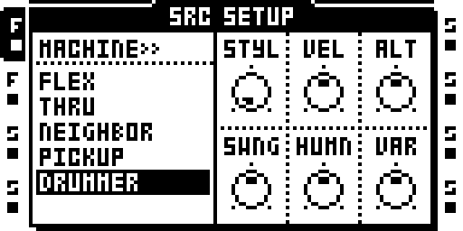

| potard | 0 | vers 127 |
|---|---|---|
| **STYL** | | le style (son nom est affiché) ; voir la liste plus bas |
| **VEL** | tous les coups au même volume | temps forts, contretemps doux (surtout les charleys), un peu de hasard ; au-delà de la moitié, des accents pleins au hasard |
| **ALT** | toujours la première slice de chaque sorte | d'autres slices de la même sorte ; au-delà de la moitié n'importe quel rôle de l'élément ; près du maximum, parfois un voisin (kick/tom, caisse claire/ghost, charleys/ride) |
| **SWNG** | carré | caisse claire en retard et charleys swingués ; au-delà de la moitié chaque double-croche paire est décalée, jusqu'au feeling triolet |
| **HUMN** | le groove intact | la dose de VEL, ALT, SWNG et VAR : 64 les joue comme réglés, 127 deux fois plus |
| **VAR** | la même mesure à chaque mesure | des fills en fin de phrase ; au-delà de la moitié le groove change d'une mesure à l'autre et les fills s'allongent (deux temps, parfois une mesure) ; près du maximum un fill à chaque fin de mesure |

HUMN est le maître de l'humanisation : à 0, VEL, ALT, SWNG et VAR ne font
rien et le groove joue tel qu'écrit. ORN et GHST ne dépendent pas de HUMN.

**Les styles** (STYL) : BRKB breakbeat, HHOP hip-hop, FUNK, HOUS house,
JUNG jungle, DUB one drop, AFRO afrobeat, CLAV son clave 3-2, BOSS bossa,
BMBE bembe 12/8, ROCK, DISC disco, TECH techno, TRAP, RNB r&b / neo-soul,
DEMB reggaeton dembow, SAMB samba, BAIA baiao, CUMB cumbia, GARA uk garage,
DSTP dubstep, SHUF blues shuffle 12/8, SIX8 6/8 afro, ELEC electro, DEEP
deep house, MINI minimal techno, AMAP amapiano, FTWK footwork, HILF
highlife. Chaque style joue tout le kit : cloches, claves, rims et shakers
sur les slices PERC, congas et log drum sur les slices TOM. Un style en
12/8 joue des mesures de 12 pas.

### KIT BALANCE : le mélange des éléments

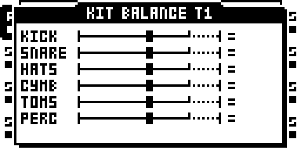

Six lignes, un potentiomètre chacune : **A KICK, B SNARE** (ses ghosts
aussi), **C HATS** (fermé et ouvert), **D CYMB** (ride, crash), **E TOMS,
F PERC**. La graduation du milieu (`=`) correspond au style écrit. À gauche,
l'élément joue moins (`-20` retire un cinquième de ses coups, `OUT` tous) ;
à droite, plus : d'abord les coups des autres niveaux du style, puis
(après la petite graduation, la barre en pointillés) n'importe quel pas
libre pour les éléments légers (charleys, perc, ghosts) et les croches
pour les autres. Un cran vaut 5 % ; le potentiomètre marque un arrêt au
milieu.

KIT BALANCE est enregistré dans la Part : chaque Part a son mélange, et un
changement de Part l'amène. Les trigs de la piste jouent toujours.

**Des locks sur les pas et les scènes.** KIT BALANCE prend des P-LOCK,
comme une page de stock (les locks de PAGES ; le remix doit contenir
EVENTS) :

- **Sur un pas.** En GRID RECORDING, posez un trig (TRIG, ou FUNC + TRIG
  pour un trigless), tenez-le et tournez A-F : le pas verrouille
  l'élément. Le titre affiche `STEP n` ; un élément verrouillé montre sa
  valeur, les autres `--`. FUNC tenu en tournant efface le lock. Comme sur
  stock, le lock joue de son pas jusqu'au trig suivant de la piste.
- **Sur une scène.** Tenez SCENE A ou B et tournez A-F : la scène
  verrouille l'élément (titre `SCENE n`), et le crossfader passe d'un
  mélange à l'autre. FUNC tenu en tournant l'efface.

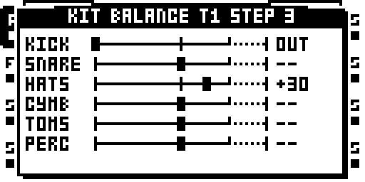

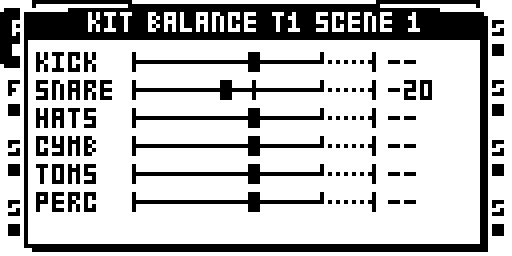

Les locks suivent leurs trigs comme ceux de stock : retirer un trig retire
ses locks, trig + PLAY les efface, et copier un trig, une piste ou un
pattern les emporte. Ils sont enregistrés avec le projet (`pglocks.work`).

### NEXT : des ordres sur le temps

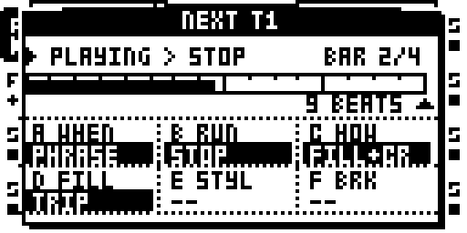

NEXT donne un ordre au batteur, comme un chef d'orchestre : « à la
prochaine phrase, un fill en triolets, et on coupe ». L'ordre attend le
temps, la mesure ou la phrase choisis et s'exécute exactement là, que tu
aies tourné le potard tôt ou tard. Les six cases sont disposées comme les
potentiomètres : A B C en haut, D E F en bas.

| potard | rôle | valeurs |
|---|---|---|
| **A WHEN** | envoie l'ordre | `--` (rien d'armé), BEAT, BAR, PHRASE, 2 PHR |
| **B RUN** | arrêter ou reprendre | `--`, STOP (les trigs de la piste jouent encore), SILENT (eux aussi se taisent) ; batteur arrêté, la case affiche RESUME |
| **C HOW** | comment il s'arrête ou revient | DRY (sec), CRASH (une crash sur le 1), FILL (un fill qui finit sur le 1), FILL+CR, PICKUP (une levée d'un demi-temps ; à la reprise, puis la crash) |
| **D FILL** | le fill de l'ordre (joué même avec B sur `--`) | `--`, TRIP, 6LET, RUDI, 3:4, LONG (une mesure entière) |
| **E STYL** | un autre style à partir du 1 | `--` ou un style ; gardé jusqu'à ce que tu tournes STYL dans CONFIG |
| **F BRK** | un break à partir du 1 | `--`, 1 BEAT, 2 BEATS, BAR (les coupes de BRK), STUTTER (une mesure de bégaiement) |

**A demande quatre crans par valeur et s'arme quand le potard s'arrête**
(une demi-seconde) : un petit mouvement ne change rien, et passer par BEAT
pour aller sur PHRASE envoie PHRASE, pas BEAT. **Seul A revient à `--`.**
Règle B à F une fois ; chaque tour de A renvoie
le même ordre (STOP, puis RESUME, puis STOP...). Une `*` marque les cases
réglées qui attendent A. Remets A à `--` avant l'exécution pour annuler.

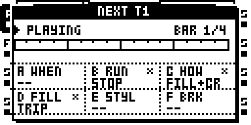

En haut de la page : l'état du batteur (PLAYING, STOPPED) et ce que fera
l'ordre armé, la mesure de la phrase à droite ; dessous, la phrase sur toute
la largeur, une case par mesure, qui se remplit avec la tête de lecture ;
une marque sous l'endroit où l'ordre s'exécute, et les temps restants à
côté. Les valeurs de l'ordre passent en inversé quand il est
armé et clignotent pendant les quatre derniers temps. À l'exécution, la
ligne flashe et A revient à `--`.

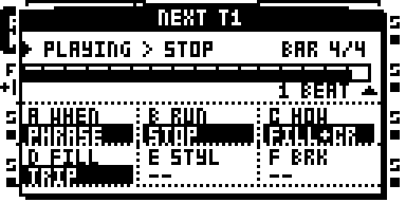

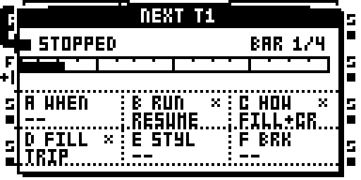

À l'arrêt, le batteur continue de compter en silence : une reprise retombe
dans le groove, sur le 1. Un fill (C sur FILL, FILL+CR ou PICKUP, ou D
réglé) demande un ordre sur le 1 d'une mesure : avec A sur BEAT au milieu
d'une mesure, l'ordre s'exécute sans son fill. Le fill dure ce que dit LONG
dans FILLS (fenêtre KIT page 4), un temps sur AUTO, une mesure avec D LONG.

Armé séquenceur arrêté, un ordre s'exécute au premier pas : un STOP armé
avant PLAY lance le pattern sans le batteur, prêt à entrer au prochain
ordre. B à F sont enregistrés dans la Part ; A ne l'est pas (un ordre est un
geste : un projet se charge toujours sans rien d'armé).

### La fenêtre KIT

Maintiens n'importe quelle **touche de trig** et appuie sur **BANK** (BANK
seul choisit toujours une banque). Une ligne par slice, quatre pages :
**LEFT / RIGHT** changent de page, **UP / DOWN** passent d'une slice à
l'autre et la jouent, une **touche de trig** saute à cette slice et la joue,
**YES** ou **NO** ferme. **FUNC + RIGHT** refait le kit d'après le son
(AUTO ; demandé d'abord).

**Page 1 : ce qu'est chaque slice.**

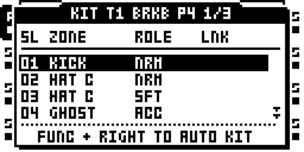

- **A ZONE** : l'élément que joue la slice : KICK, SNARE, GHOST, HAT C,
  HAT O, RIDE, CRASH, TOM, PERC, un combo de deux éléments (un kick et une
  crash frappés ensemble, par exemple), ou OUT (jamais joué comme élément).
- **B ROLE** : ACC (accent : coups forts), NRM, SFT (coups doux). DRUMMER
  choisit le rôle d'après le volume du coup : une caisse claire forte joue
  une slice ACC, une douce une slice SFT.
- **LNK** affiche `=n` sur les slices qu'AUTO a reconnues comme copies de
  la slice n (SIMILAR, page 3).

**Page 2 : calage, niveau, scène.**

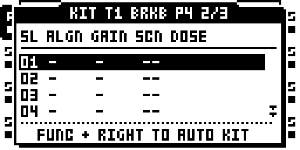

- **A ALGN**, 0-250 ms : la slice démarre d'autant plus tôt, pour qu'un
  coup placé tard dans sa slice tombe sur le pas. AUTO le règle quand il
  trouve le coup tard dans la slice.
- **B GAIN**, -24 à +6 dB : le niveau propre de la slice, en plus de la
  vélocité du coup. Sur une slice liée, tout son groupe suit.
- **E SCN**, -- ou 1-16 : une scène de la Part jouée sur les coups de
  cette slice seulement (ses verrous de LFO, AMP, FX1 et FX2 pour cette
  piste). Garde quelques scènes pour les slices (9-16 par exemple) et les
  autres pour le crossfader. Un départ delay sur une seule slice, un filtre
  sur le charley ouvert...
- **F DOSE**, 5-100 % : jusqu'où aller vers les valeurs de la scène.

**Page 3 : la piste.**

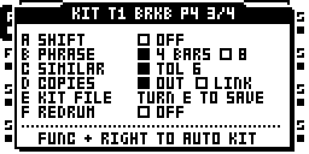

- **A SHIFT** : sur ON, un coup léger (ghost, charley, perc) qui perd une
  collision avec un coup plus fort passe au pas libre suivant au lieu
  d'être supprimé.
- **B PHRASE** : 4 ou 8 mesures, la phrase que suivent les fills et les
  crashs de VAR.
- **C SIMILAR** : à quel point deux slices doivent se ressembler pour
  qu'AUTO considère l'une comme copie de l'autre (OFF, 1-15 ; 6 par défaut).
- **D COPIES** : ce qu'AUTO fait des copies : OUT (hors du kit) ou LINK
  (gardées, liées : leur GAIN bouge ensemble).
- **E KIT FILE** : tourne E pour enregistrer le kit dans un fichier à côté
  du sample. La prochaine fois que ce sample arrive sur une piste DRUMMER,
  son kit se charge sans poser la question.
- **F REDRUM** : OFF, AUTO, 1, 2, 4 ou 8 BARS (voir *REDRUM* plus bas). La
  ligne affiche ce que REDRUM a compris de la boucle, par exemple
  `AUTO 1BAR 16SL`.

SIMILAR et COPIES s'appliquent au prochain AUTO. Le kit, GAIN, ALIGN,
SCENE, DOSE et les réglages de la page 3 sont enregistrés avec le projet,
par piste.

**Page 4 : FILLS, le vocabulaire des fills.**

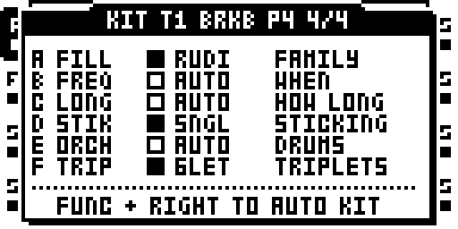

Six choix, chacun commençant par AUTO (AUTO laisse le style, VAR et ORN
décider). Une case pleine marque un choix fait à la main :

| potard | choix |
|---|---|
| **A FILL** | le type de chaque fill : WRIT (le fill écrit du style), RUDI (rudiments), TRIP (triolets), 3:4 (groupes de trois sur quatre) |
| **B FREQ** | quand : AUTO (les fills de BRK, et ceux de VAR), BRK (seulement quand BRK le demande), 2BAR (ceux de BRK, une mesure sur deux), PHRS (ceux de BRK, en fin de phrase) |
| **C LONG** | combien de temps : AUTO (la zone de BRK décide), 1BT, 2BT, BAR |
| **D STIK** | un doigté du type choisi en A (`--` tant que A est sur AUTO ou WRIT) |
| **E ORCH** | quels éléments : TOMS (main droite autour des toms, gauche sur la caisse claire), SNR (tout sur la caisse claire), SWAP |
| **F TRIP** | les triolets : 8TH (triolets de croches), 6LET (sextolets), 8>6 (des croches qui passent en sextolets sur le dernier temps). Réglé alors que A est sur AUTO, les fills passent en triolets |

Les doigtés (D) : rudiments SNGL coups simples, DBLE coups doubles, PARA
paradiddle, INVP paradiddle inversé, PDDL paradiddle-diddle, SIXS
roulement de six, DPAR double paradiddle, LIN3 / LIN4 linéaire avec le
kick, FTAP flam tap, DRAG single drag tap, RTMQ ratamacue, FIVE roulement de
cinq ; triolets TRPL coups simples, RLL, SIXS six coups, PDDL
paradiddle-diddle, LIN linéaire, SWIS swiss army triplet, FACC flam accent ;
3:4 TSS (tom caisse caisse), LIN, KSS (kick caisse caisse), FSS (fla caisse
caisse).

FILLS est enregistré dans la Part, comme KIT BALANCE. Modifié pendant que
le pattern joue, le fill suivant en tient compte. Pour un seul fill
différent de ceux-ci, utilise D FILL dans NEXT.

## Comment le kit est fait

**AUTO** écoute chaque slice : combien de graves, combien d'aigus, combien
de temps elle résonne. Beaucoup de graves, c'est un kick ; des aigus et peu
de graves, un charley (ouvert s'il tient) ; une résonance d'une seconde ou
plus, une cymbale ; des aigus sur un peu moins de graves, une caisse claire
(une douce, un ghost) ; une résonance plus grave, un tom ; le reste, une
perc. Dans chaque élément, les slices les plus fortes deviennent ACC et les
plus douces SFT. AUTO fait une proposition : corrige une zone dans la
fenêtre KIT, page 1, et la correction s'entend tout de suite.

**SIMILAR.** Une boucle frappe souvent le même son plusieurs fois (une
boucle de deux mesures dont la deuxième répète la première). AUTO repère
les copies et en garde une de chaque : avec COPIES sur OUT les autres
sortent du kit (la notification dit `5 SIMILAR OUT`), avec LINK elles
restent et sont liées. Une copie plus douce de 6 dB ou plus est gardée
comme SFT.

**Collisions.** Une piste joue une slice à la fois. Quand le groove demande
deux éléments sur le même pas, une slice combo qui contient exactement ces
deux-là joue ; sinon l'élément le plus prioritaire (le kick d'abord, puis
la caisse claire, puis les autres).

## REDRUM : ta boucle comme groove

Avec REDRUM sur ON, DRUMMER place chaque slice là où elle tombe dans ta
boucle (en gardant son décalage par rapport à la double-croche, donc le
feeling) et cette boucle devient le groove. **HUMN 0, SEED 0, CPLX 64**
rejoue la boucle telle quelle, chaque pas avec sa propre slice. Ensuite les
potentiomètres la déforment :

| potard | avec REDRUM |
|---|---|
| ALT (avec HUMN) | de temps en temps une slice est remplacée par une autre du même élément : le re-drum |
| SEED | déplace, vide et remplit des coups, comme sur un style |
| DENS | allège la boucle sous 64 (l'ossature reste) |
| CPLX | 0 : la boucle sans ses slices douces ni ses ghosts ; 64 : la boucle ; 127 : la boucle plus les coups COMPLEX du style sur les pas qu'elle laisse libres (ses propres coups ne perdent jamais) |
| GHST, VAR, ORN, BRK, VEL | comme sur un style : ghosts, mesures qui changent, ornements, fills et breaks, nuances |
| STYL | donne ses fills (et leur couleur), pas son groove, son swing ni son retard de caisse claire : la boucle a les siens |
| KIT BALANCE | comme sur un style, par élément |

Les slices que SIMILAR a sorties du kit jouent quand même sur leurs propres
pas, telles quelles (KIT BALANCE et SEED ne les touchent pas) ; avec COPIES
sur LINK elles restent dans leur élément et tous les potentiomètres les
atteignent.

**Quelle longueur fait la boucle ?** REDRUM a besoin de la longueur de la
boucle en mesures pour la poser sur les pas. Sur **AUTO**, il lit les
attributs du slot (sa longueur en mesures, sinon son tempo) et prend le
nombre de mesures entier le plus proche parmi 1, 2, 4 ou 8. Un slot qui n'a
jamais eu son propre tempo prend celui du projet, ce qui peut faire lire
une boucle à 150 BPM comme 6,4 mesures à 120 : AUTO arrondit à 8. Si la
ligne affiche un mauvais nombre de mesures, **règle-le à la main** : 1, 2, 4
ou 8 BARS sur F. Une longueur imposée ignore le tempo du slot, et la boucle
suit alors le projet à n'importe quel tempo.

Une boucle plus longue que le pattern continue simplement : une boucle de
4 mesures sur un pattern de 16 pas joue ses quatre mesures en quatre
passages.

## Configurations

**Un groove stable pour un morceau.** CONFIG : le style, HUMN 0. LIVE :
SEED 0, DENS 64, CPLX 64, BRK 0. Toutes les mesures identiques, le style
tel qu'écrit.

**Un batteur humain.** HUMN 64, VEL 64, SWNG 40-70, ALT 40. Ajoute VAR 40
pour des fills en fin de phrase, ORN 32 pour les flas et roulements,
GHST 40.

**Plus ou moins chargé.** DENS et CPLX sont les deux potentiomètres de
densité : CPLX parcourt les niveaux écrits (plus de parties, plus de
syncopes), DENS allège ou remplit au hasard autour. Un breakdown : DENS 20.
Un sommet : CPLX 127, DENS 90.

**Breaks au crossfader.** Mets BRK sur une scène : maintiens SCENE B,
tourne BRK à 56 (une mesure de fill) ou 110 (bégaiements) ; SCENE A garde
BRK à 0. Le crossfader fait alors passer le batteur du groove au break et
retour, et un fill d'un temps ou plus retombe sur une crash.

**Des fills seulement quand tu veux.** Fenêtre KIT page 4 (FILLS) : FREQ sur BRK (aucun fill
sauf si BRK le demande), LONG 1BT ; une scène avec BRK 40 au crossfader
donne alors un fill d'un temps à la demande. FREQ 2BAR ou PHRS : une mesure
sur deux, ou en fin de phrase.

**Des fills en triolets.** Fenêtre KIT page 4 (FILLS) : TRIP 6LET
(sextolets), FILL sur AUTO ou TRIP.

**Une fin de morceau.** NEXT : B STOP, C FILL+CR, D LONG. Vers la fin, tourne
A sur PHRASE : une mesure de fill, une crash sur le 1 de la phrase suivante,
puis le silence. A encore sur PHRASE (B affiche maintenant RESUME), C
PICKUP : le batteur revient sur une levée et une crash.

**Couper la batterie une mesure.** NEXT : B STOP, C DRY. A sur BAR arrête à
la mesure suivante ; A sur BAR encore la fait revenir à celle d'après. Avec
B SILENT, les trigs de la piste se taisent aussi.

**Changer de style sur la phrase.** NEXT : E sur le style suivant, B `--`.
A sur PHRASE : le nouveau style dès le 1 de la phrase ; tourner STYL dans
CONFIG rend la main au potentiomètre.

**Une slice, un effet.** Fenêtre KIT page 2 : donne SCN 9 au charley
ouvert, et sur la scène 9 verrouille le filtre de la piste ; le charley
ouvert joue filtré, le reste intact. Un départ delay sur la caisse claire
seule, un pitch sur les toms...

**Deux batteurs.** Deux pistes DRUMMER sur la même boucle, avec des SEED ou
des styles différents, l'une avec KIT BALANCE qui garde kick et caisse
claire, l'autre charleys et percs.

**Ton propre kit à partir de coups isolés.** Un outil sur ordinateur, à
côté du module (le kit maker, voir la partie Reference du README), fait
d'un dossier de coups isolés un seul sample découpé avec son fichier de
kit, prêt pour la carte.

## Tuto 1 : un batteur à partir d'une boucle slicée

Il te faut une boucle de batterie d'une ou deux mesures sur la carte.

1. **Charger et découper.** Sur la piste 1, charge la boucle sur une
   machine FLEX. AED (éditeur audio), SLICE : *create slice grid*, 16 slices
   pour une mesure (32 pour deux). Vérifie que chaque slice commence sur un
   coup.
2. **En faire un batteur.** FUNC + SRC, descends jusqu'à **DRUMMER**,
   **YES**, puis **NO** pour fermer. À *This track has no kit yet*, réponds
   **YES** : la notification dit combien de slices il a rangées.
3. **Vérifier le kit.** Maintiens le trig 1, appuie sur **BANK** : la
   fenêtre KIT, page 1. UP / DOWN joue chaque slice avec sa zone. Un
   charley pris pour une perc ? Tourne A sur HAT C. Ferme avec **NO**.
4. **Choisir un style.** FUNC + SRC (CONFIG), tourne **STYL** sur FUNK.
   HUMN 0. **PLAY** : un groove funk carré avec les sons de ta boucle.
5. **Le façonner.** SRC (LIVE). CPLX 0 : le funk le plus simple ; 127 : le
   plus chargé. DENS 30 : clairsemé. Reviens à 64 et 64. Tourne **SEED**
   doucement : chaque valeur est la version d'un autre batteur sur le même
   style ; `TBL`, c'est la partition.
6. **Le faire respirer.** CONFIG : HUMN 64, VEL 70, SWNG 50, ALT 40.
   LIVE : GHST 50, ORN 32. La caisse claire traîne, les charleys swinguent,
   les ghosts et les flas arrivent.
7. **Mixer les éléments.** SRC encore (KIT BALANCE). Charleys à `-40`, kick
   à `+20`. Fenêtre KIT page 4 (FILLS) : FILL RUDI, ORCH TOMS.
8. **Les breaks.** Maintiens SCENE B et tourne BRK à 56 sur LIVE ; relâche.
   Maintiens SCENE A, BRK 0. Pousse le crossfader vers B vers la fin d'une
   mesure : un fill aux toms, qui retombe sur une crash. Sur une deuxième
   scène, BRK 110 : des bégaiements.
9. **Arrêter sur la phrase.** SRC encore (NEXT) : B STOP, C FILL+CR.
   Tourne A sur PHRASE : le compte à rebours défile, un fill, une crash sur
   le 1, le silence. A encore sur PHRASE : le batteur revient à la phrase
   suivante.
10. **Enregistrer.** SAVE PROJECT garde le kit, les potentiomètres, KIT
   BALANCE, FILLS et les ordres de NEXT. Fenêtre KIT page 3, E : le fichier de kit, pour que
   cette boucle n'ait plus jamais besoin de la question.

## Tuto 2 : REDRUM, re-jouer ton break

Il te faut une boucle dont tu aimes le groove, découpée un coup par slice.

1. **Préparer** comme au tuto 1, étapes 1 à 3 (charger, découper, DRUMMER,
   AUTO YES). Pour une boucle avec beaucoup de coups répétés, mets COPIES
   sur LINK en page 3 *avant* AUTO (ou fais FUNC + RIGHT dans la fenêtre
   KIT pour le refaire), afin que chaque slice reste dans son élément.
2. **Activer REDRUM.** Fenêtre KIT, page 3 (RIGHT deux fois), tourne **F**
   d'un cran : `AUTO 1BAR 16SL`. Vérifie les mesures : une boucle d'une
   mesure doit afficher 1BAR, une de deux mesures 2BAR. Faux ? Continue à
   tourner F jusqu'au bon nombre de mesures.

   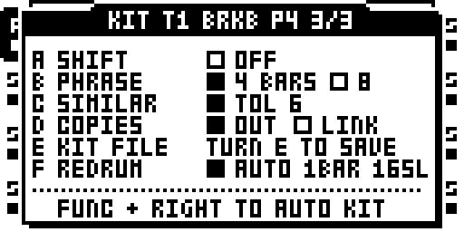

3. **Écouter la boucle elle-même.** CONFIG : HUMN 0. LIVE : SEED 0,
   CPLX 64, DENS 64, BRK 0, GHST 0, ORN 0. **PLAY** : ta boucle, slice par
   slice, telle qu'elle a été jouée, qui suit maintenant le tempo du projet.
4. **La re-jouer.** CONFIG : HUMN 64, ALT 60 : de temps en temps une caisse
   claire devient une autre caisse claire, un kick un autre kick. LIVE :
   tourne SEED : des coups bougent, disparaissent, apparaissent, toujours
   avec les sons de la boucle.
5. **Alléger, épaissir.** CPLX 0 : la boucle sans ses ghosts ni ses coups
   doux, un break dépouillé. CPLX 127 avec STYL HOUS : la boucle plus des
   charleys house sur les pas qu'elle laisse libres. DENS 30 : une version
   clairsemée.
6. **Fills et breaks.** STYL choisit la couleur des fills (ROCK, FUNK,
   JUNG...). Fenêtre KIT page 4 (FILLS) : TRIP 6LET pour des fills en sextolets. Mets BRK 56 sur
   une scène pour une mesure de fill au crossfader, BRK 110 pour des
   bégaiements ; un fill retombe sur une crash.
7. **Le feeling.** VEL 60 redonne des nuances sur les temps ; GHST 40
   ajoute des ghost notes que l'original n'avait pas.
8. **Retour à la source.** HUMN 0, SEED 0, CPLX 64 : la boucle d'origine.
   REDRUM est un réglage par piste, enregistré avec le projet ; OFF rend le
   style.
