# `drummer` — DRUMMER

Author: [djib](https://github.com/Djibdjib). Machine row seams from ANALOG BD
([repeat98](https://github.com/repeat98)); KIT window drawn as CHORDS' and
SCALES' choosers; drummer.work through [STORE](../store/README.md).

**Contents:** [What it does](#what-it-does) · [Quick start](#quick-start) ·
[The pages](#the-pages) · [How a kit is made](#how-a-kit-is-made) ·
[REDRUM](#redrum-your-loop-as-the-groove) · [Configurations](#configurations) ·
[Tutorial 1: a drummer from a sliced loop](#tutorial-1-a-drummer-from-a-sliced-loop) ·
[Tutorial 2: REDRUM](#tutorial-2-redrum-re-drum-your-break) · [Reference](#reference) ·
[Version française](README.fr.md)

The screens are captured from the emulator (`tools/site/capture_manual.py drummer`,
a synthetic loop made by `manual_fixture.py`).

## What it does

DRUMMER turns a FLEX track holding a **sliced drum sample** into a drummer.
You give it a loop (or a kit of one-shots) cut into slices; it sorts the
slices into drums and plays them, live, in a style you pick. Nothing is
written into the pattern: at every step DRUMMER decides which slice plays,
how loud and how early or late, from a handful of knobs. Turn them while it
plays and the drummer follows: simpler or busier, straighter or looser,
with fills, ghost notes, breaks on the crossfader.

It has two ways of playing:

- **A style** (REDRUM OFF). DRUMMER plays one of 29 written grooves
  (breakbeat, funk, house, jungle, dub, afrobeat, bossa, techno, trap...)
  with the sounds of your kit.
- **REDRUM** (ON). DRUMMER plays **your loop's own groove**, slice by slice,
  and the same knobs bend it: replay the break as it is, then thin it, swap
  its hits, add ghosts, fills and breaks.

The track stays a FLEX track: its sample, slices, AMP, LFOs and effects are
FLEX's, and a project opened on a stock Octatrack finds a plain FLEX track.

## Where to find it

DRUMMER is in the `drummer` test remix. It needs STORE (the kits are saved
with the project) and PAGES (KIT BALANCE and FILLS). Any of the eight
tracks can be a DRUMMER track, each with its own kit.

## Quick start

1. Load a drum loop on a FLEX track and **slice it** in the audio editor
   (a grid, transients or by hand: DRUMMER reads the slices, it never moves
   them). One hit a slice works best.
2. **FUNC + SRC** opens the machine list. Scroll down: **DRUMMER** is the
   last row. **YES** makes the track a DRUMMER track and shows its CONFIG
   knobs (RIGHT on the row picks another sample first).

   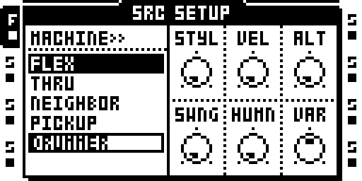

3. Close with **NO**: DRUMMER asks to make a kit. **YES**: it listens to
   every slice and sorts it (kick, snare, hats...); the toast says how many
   slices it sorted. **NO** leaves the kit empty; then only the track's own
   trigs play.

   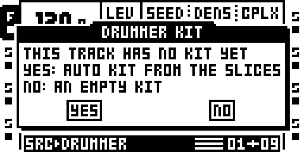

   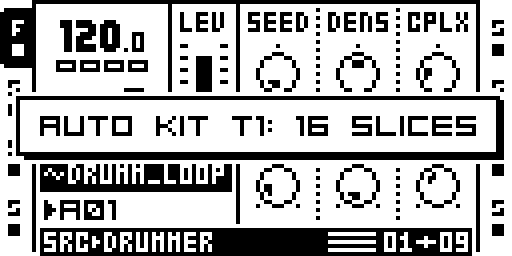

4. **PLAY**. The track plays the style shown on CONFIG (BRKB, a breakbeat,
   at first). Turn the knobs.

You do not need a single trig on the track. A trig you place still plays:
it is an accent (on an empty step, a kick on the beat, else a snare).

## The pages

A DRUMMER track has five screens of its own. **SRC** cycles the first three
(LIVE, KIT BALANCE, FILLS); **FUNC + SRC** opens CONFIG; **a trig key held +
BANK** opens the KIT window.

| screen | open with | what is on it |
|---|---|---|
| LIVE | SRC | the six knobs you play: SEED DENS CPLX ORN BRK GHST |
| KIT BALANCE | SRC again | how much each group of drums plays |
| FILLS | SRC a third time | the fills, set by hand |
| CONFIG | FUNC + SRC | the style and the feel: STYL VEL ALT SWNG HUMN VAR |
| KIT window | hold a trig, press BANK | the kit: each slice's drum, level, timing; the track's settings and REDRUM |

### LIVE: the knobs you play

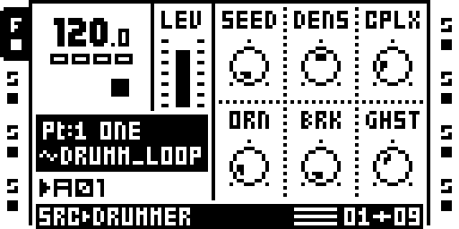

| knob | 0 | 64 | 127 |
|---|---|---|---|
| **SEED** | the style as written | a variation of it | the furthest variation |
| **DENS** | almost nothing: the backbone only | the style as written | busier: extra hits drawn from the complex version |
| **CPLX** | the BASIC version of the style | STANDARD | COMPLEX |
| **ORN** | no ornaments | flams on loud snares, rolls closing fills | ruffs, doubled and tripled hats too |
| **BRK** | the groove | (see below) | stutters and repeats |
| **GHST** | no ghost notes | some | many soft snares around the backbeat |

**SEED** picks a variation of the style: `TBL` at 0 is the style as written;
then eight bands of sixteen variations, shown `band:variant` (`1:01` ...
`8:15`). The band says how far the variation goes (band 1 touches about one
cell in eight, band 8 more than half), and a variation keeps its character
from band to band, only stronger. The kick on 1 and the snares on 2 and 4
never move. The same SEED always replays the same performance from PLAY.

**CPLX** goes through the style's three written levels, BASIC, STANDARD and
COMPLEX, adding the next level's hits one at a time. The screen shows where
you are: `BAS`, `STD`, `CPX`, and in between `B>50` (half-way from BASIC to
STANDARD) or `S>25` (a quarter of the way to COMPLEX).

**BRK** is the break knob, made for the crossfader (lock it on a scene, see
*Breaks on the crossfader* below). Its range is in zones:

| BRK | what happens |
|---|---|
| 0 | the groove |
| 1-31 | more of the style's busier layer, a little more each step |
| 32-63 | a fill closes every bar: half a beat at 32, one beat from 40, two from 48, a whole bar from 56. A fill of a beat or more lands on a crash on the next 1 |
| 64-79 | slices drawn from the whole kit: the groove scrambles |
| 80-95 | the same, half-time (one snare, on 3) |
| 96-127 | per beat, cuts: the beat repeats the last hit as a stutter on every 16th (tighter past 112), and now and then a beat drops out (never the 1, never two in a row) |

Back to 0, the groove returns exactly where it would have been.

**GHST** adds soft snares on free steps near the backbeat, from the kit's
GHOST slices, or a soft SNARE when there are none. KIT BALANCE's SNARE row
scales them.

### CONFIG: the style and the feel

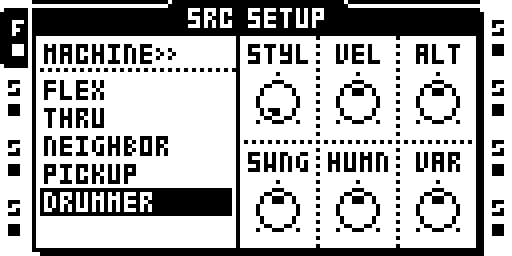

| knob | 0 | towards 127 |
|---|---|---|
| **STYL** | | the style (its name is shown); see the list below |
| **VEL** | every hit as loud | beats loud, off-beats soft (hats most), some chance; past half, random full accents |
| **ALT** | always the first slice of each kind | other slices of the same kind; past half any role of the drum; near the top, now and then a neighbour (kick/tom, snare/ghost, hats/ride) |
| **SWNG** | straight | a laid-back snare and swung hats; past half every off-16th shuffles, up to a triplet feel |
| **HUMN** | the groove untouched | the amount of VEL, ALT, SWNG and VAR: 64 plays them as set, 127 twice as far |
| **VAR** | the same bar every bar | fills at the end of each phrase; past half the groove changes from bar to bar and fills grow (two beats, sometimes a bar); near the top a fill at every bar's end |

HUMN is the master of the humanisation: at 0, VEL, ALT, SWNG and VAR do
nothing, and the groove plays as written. ORN and GHST are not scaled by
HUMN.

**The styles** (STYL): BRKB breakbeat, HHOP hip-hop, FUNK, HOUS house,
JUNG jungle, DUB one drop, AFRO afrobeat, CLAV son clave 3-2, BOSS bossa,
BMBE bembe 12/8, ROCK, DISC disco, TECH techno, TRAP, RNB r&b / neo-soul,
DEMB reggaeton dembow, SAMB samba, BAIA baiao, CUMB cumbia, GARA uk garage,
DSTP dubstep, SHUF blues shuffle 12/8, SIX8 6/8 afro, ELEC electro, DEEP
deep house, MINI minimal techno, AMAP amapiano, FTWK footwork, HILF
highlife. Every style plays the whole kit: bells, claves, rims and shakers
on the PERC slices, congas and the log drum on the TOM slices. A 12/8 style
plays bars of 12 steps.

### KIT BALANCE: the mix of the drums

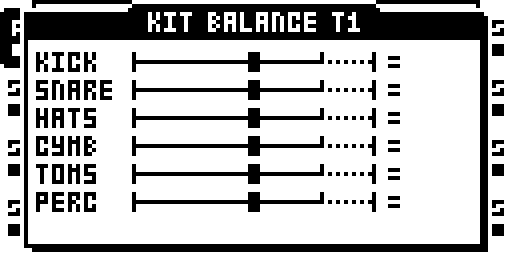

Six rows, one knob each: **A KICK, B SNARE** (its ghosts too), **C HATS**
(closed and open), **D CYMB** (ride, crash), **E TOMS, F PERC**. The middle
tick (`=`) is the style as written. Left of it the drum plays less (`-20`
takes a fifth of its hits out, `OUT` all of them); right of it, more: first
the hits of the style's other levels, then (past the small tick, the bar
dotted) any free step for the light drums (hats, perc, ghosts) and the
8ths for the others. One detent is 5 %; turning stops once on the middle.

KIT BALANCE is saved in the Part: each Part has its own mix, and a Part
change brings it. The track's own trigs always play.

### FILLS: the fills by hand

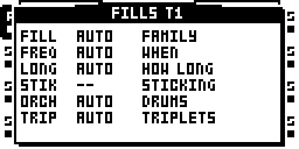

Six choices, each AUTO first (AUTO lets the style, VAR and ORN decide):

| knob | choices |
|---|---|
| **A FILL** | the kind of every fill: WRIT (the style's written fill), RUDI (drum rudiments), TRIP (triplets), 3:4 (groups of three over four) |
| **B FREQ** | when: AUTO (BRK's fills, and VAR's), BRK (only when BRK asks), 2BAR (BRK's, every second bar), PHRS (BRK's, at the phrase's end) |
| **C LONG** | how long: AUTO (BRK's zone says), 1BT, 2BT, BAR |
| **D STIK** | one sticking of the kind chosen in A (`--` while A is AUTO or WRIT) |
| **E ORCH** | which drums: TOMS (right hand round the toms, left on the snare), SNR (all on the snare), SWAP |
| **F TRIP** | triplets: 8TH (8th triplets), 6LET (sextuplets), 8>6 (8ths turning into sextuplets on the last beat). Set while A is AUTO, the fills become triplets |

The stickings (D): rudiments SNGL single stroke, DBLE double stroke, PARA
paradiddle, INVP inverted paradiddle, PDDL paradiddle-diddle, SIXS
six-stroke roll, DPAR double paradiddle, LIN3 / LIN4 linear with the kick,
FTAP flam tap, DRAG single drag tap, RTMQ ratamacue, FIVE five-stroke roll;
triplets TRPL single stroke, RLL, SIXS six-stroke, PDDL paradiddle-diddle,
LIN linear, SWIS Swiss army triplet, FACC flam accent; 3:4 TSS
(tom snare snare), LIN, KSS (kick snare snare), FSS (flam snare snare).

FILLS is saved in the Part, like KIT BALANCE. Changed while the pattern
plays, the next fill takes it.

### The KIT window

Hold any **trig key** and press **BANK** (BANK alone still selects a bank).
One row a slice, three pages: **LEFT / RIGHT** change page, **UP / DOWN**
move from slice to slice and play it, a **trig key** jumps to that slice
and plays it, **YES** or **NO** closes. **FUNC + RIGHT** makes the kit
again from the sound (AUTO; asked first).

**Page 1: what each slice is.**

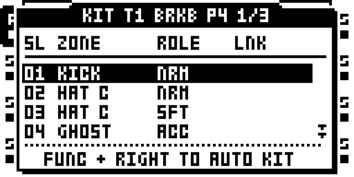

- **A ZONE**: the drum the slice plays: KICK, SNARE, GHOST, HAT C, HAT O,
  RIDE, CRASH, TOM, PERC, a two-drum combo (a kick and a crash hit
  together, say), or OUT (never played as a drum).
- **B ROLE**: ACC (accent: loud hits), NRM, SFT (soft hits). DRUMMER picks
  the role from the hit's level: a loud snare plays an ACC snare, a soft
  one an SFT snare.
- **LNK** shows `=n` on slices AUTO found to be copies of slice n
  (SIMILAR, page 3).

**Page 2: timing, level, scene.**

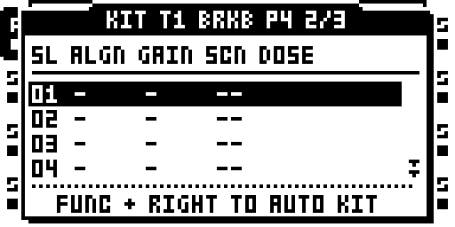

- **A ALGN**, 0-250 ms: the slice starts that much early, so a hit that
  sits late in its slice lands on the step. AUTO sets it when it finds the
  hit late in the slice.
- **B GAIN**, -24 to +6 dB: the slice's own level, on top of the hit's
  velocity. On a linked slice, its whole group turns.
- **E SCN**, -- or 1-16: a scene of the Part played on this slice's hits
  only (its LFO, AMP, FX1 and FX2 locks for this track). Keep a few scenes
  for the slices (9-16, say) and the others for the crossfader. A delay
  send on one slice only, a filter on the open hat...
- **F DOSE**, 5-100 %: how far towards the scene's values.

**Page 3: the track.**

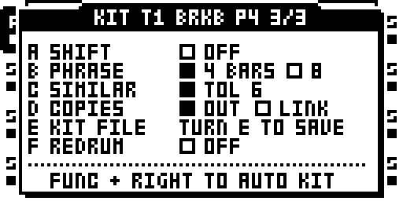

- **A SHIFT**: ON, a light hit (ghost, hat, perc) that loses a collision
  with a louder one moves to the next free step instead of being dropped.
- **B PHRASE**: 4 or 8 bars, the phrase VAR's fills and crashes follow.
- **C SIMILAR**: how close two slices must sound for AUTO to call one a
  copy of the other (OFF, 1-15; 6 by default).
- **D COPIES**: what AUTO does with the copies: OUT (out of the kit) or
  LINK (kept, linked: their GAIN turns together).
- **E KIT FILE**: turn E to save the kit in a file beside the sample. The
  next time that sample goes on a DRUMMER track, its kit loads without the
  question.
- **F REDRUM**: OFF, AUTO, 1, 2, 4 or 8 BARS (see *REDRUM* below). The row
  shows what REDRUM understood of the loop, e.g. `AUTO 1BAR 16SL`.

SIMILAR and COPIES act at the next AUTO. The kit, GAIN, ALIGN, SCENE,
DOSE and the page 3 settings are saved with the project, per track.

## How a kit is made

**AUTO** listens to each slice: how much low end, how much high end, how
long it rings. A lot of low end is a kick; high end and little low a hat
(open when it holds); a ring of a second or more a cymbal; some highs over
less low end a snare (a soft one a ghost); a lower ring a tom; anything else
a perc. Within each drum, the loudest slices become ACC and the softest
SFT. AUTO is a proposal: correct a zone in the KIT window, page 1, and it
plays at once.

**SIMILAR.** A loop often hits the same sound many times (a two-bar loop
whose second bar repeats the first). AUTO spots the copies and keeps one
of each: with COPIES on OUT the others leave the kit (the toast says
`5 SIMILAR OUT`), with LINK they stay and are linked. A copy 6 dB softer or
more is kept as an SFT.

**Collisions.** A track plays one slice at a time. When the groove asks for
two drums on one step, a combo slice holding exactly those two plays; else
the drum first in the priority (kick first, then snare, then the others).

## REDRUM: your loop as the groove

With REDRUM on, DRUMMER places every slice where it falls in your loop
(its place off the 16th kept, so the feel survives) and that loop becomes
the groove. **HUMN 0, SEED 0, CPLX 64** replays the loop as it is, each step
its own slice. Then the knobs bend it:

| knob | under REDRUM |
|---|---|
| ALT (with HUMN) | now and then a slice is swapped for another of the same drum: the re-drum |
| SEED | moves, empties and fills hits, as on a style |
| DENS | thins the loop below 64 (the backbone kept) |
| CPLX | 0: the loop without its soft slices and ghosts; 64: the loop; 127: the loop plus the style's COMPLEX hits on the steps the loop leaves free (the loop's own hits never lose) |
| GHST, VAR, ORN, BRK, VEL | as on a style: ghosts, changing bars, ornaments, fills and breaks, dynamics |
| STYL | gives its fills (and their colour), not its groove, swing or lay-back: the loop has its own |
| KIT BALANCE | as on a style, per drum |

Slices that SIMILAR put OUT of the kit still play on their own steps, as
they are (KIT BALANCE and SEED do not reach them); with COPIES on LINK they
stay in their drum and every knob reaches them.

**How long is the loop?** REDRUM needs the loop's length in bars to lay it
on the steps. On **AUTO** it reads the slot's attributes (its length in bars,
else its tempo) and takes the nearest of 1, 2, 4 or 8 whole bars. A slot
that never had its own tempo takes the project's, which can make a 150 BPM
loop read as 6.4 bars at 120: AUTO rounds it to 8. When the row shows the
wrong number of bars, **set it by hand**: 1, 2, 4 or 8 BARS on F. A forced
length ignores the slot's tempo, so the loop follows the project at any
tempo.

A loop longer than the pattern simply goes on: a 4-bar loop on a 16-step
pattern plays its four bars over four passes.

## Configurations

**A steady groove for a song.** CONFIG: the style, HUMN 0. LIVE: SEED 0,
DENS 64, CPLX 64, BRK 0. Every bar the same, the style as written.

**A human drummer.** HUMN 64, VEL 64, SWNG 40-70, ALT 40. Add VAR 40 for
fills at the phrase's end, ORN 32 for flams and rolls, GHST 40.

**More and less.** DENS and CPLX are the two "busier" knobs: CPLX walks
through the written levels (more parts, more syncopation), DENS thins or
fills at random around them. A breakdown: DENS 20. A peak: CPLX 127,
DENS 90.

**Breaks on the crossfader.** Put BRK on a scene: hold SCENE B, turn BRK
to 56 (a bar of fill) or 110 (stutters); SCENE A keeps BRK 0. The
crossfader then takes the drummer from the groove to the break and back,
and a fill of a beat or more lands on a crash.

**Fills only where you want them.** FILLS: FREQ on BRK (no fill unless BRK
asks), LONG 1BT; then a scene with BRK 40 on the crossfader gives a one-beat
fill on demand. FREQ 2BAR or PHRS: every second bar, or at the phrase's
end.

**Triplet fills.** FILLS: TRIP 6LET (sextuplets), FILL on AUTO or TRIP.

**One slice, one effect.** KIT window page 2: give the open hat SCN 9, and
on scene 9 lock the track's filter; the open hat plays filtered, the rest
untouched. A delay send on the snare alone, a pitch on the toms...

**Two drummers.** Two DRUMMER tracks on the same loop, different SEEDs or
styles, one with KIT BALANCE keeping kick and snare, the other hats and
perc.

**Your own kit from one-shots.** A computer tool beside the module
(the kit maker, see the module's README) turns a folder of single hits
into one sliced sample with its kit file, ready for the card.

## Tutorial 1: a drummer from a sliced loop

You need a drum loop of one or two bars on the card.

1. **Load and slice.** On track 1, load the loop on a FLEX machine. AED
   (audio editor), SLICE: *create slice grid*, 16 slices for one bar (32
   for two bars). Check that each slice starts on a hit.
2. **Make it a drummer.** FUNC + SRC, scroll to **DRUMMER**, **YES**, then
   **NO** to close. To *This track has no kit yet* answer **YES**: the
   toast says how many slices it sorted.
3. **Check the kit.** Hold trig 1, press **BANK**: the KIT window, page 1.
   UP / DOWN plays each slice with its zone. A hat called a perc? Turn A
   to HAT C. Close with **NO**.
4. **Pick a style.** FUNC + SRC (CONFIG), turn **STYL** to FUNK. HUMN 0.
   **PLAY**: a straight funk groove with your loop's sounds.
5. **Shape it.** SRC (LIVE). CPLX 0: the simplest funk; 127: the busiest.
   DENS 30: sparse. Back to 64 and 64. Turn **SEED** slowly: each value is
   another drummer's take on the same style; `TBL` is the book.
6. **Make it breathe.** CONFIG: HUMN 64, VEL 70, SWNG 50, ALT 40. LIVE:
   GHST 50, ORN 32. Now the snare lays back, the hats swing, ghosts and
   flams come in.
7. **Mix the drums.** SRC again (KIT BALANCE). Hats to `-40`, kick to
   `+20`. SRC again (FILLS): FILL RUDI, ORCH TOMS.
8. **Breaks.** Hold SCENE B and turn BRK to 56 on LIVE; let go. Hold
   SCENE A, BRK 0. Move the crossfader towards B near the end of a bar: a
   tom fill, landing on a crash. Further on a second scene, BRK 110:
   stutters.
9. **Save.** SAVE PROJECT keeps the kit, the knobs, KIT BALANCE and FILLS.
   KIT window page 3, E: the kit file, so this loop never needs the
   question again.

## Tutorial 2: REDRUM, re-drum your break

You need a loop whose groove you like, sliced one hit a slice.

1. **Set up** as in tutorial 1, steps 1-3 (load, slice, DRUMMER, AUTO
   YES). For a loop with many repeated hits, set page 3's COPIES to LINK
   *before* AUTO (or press FUNC + RIGHT in the KIT window to redo it), so
   every slice stays in its drum.
2. **Turn REDRUM on.** KIT window, page 3 (RIGHT twice), turn **F** once:
   `AUTO 1BAR 16SL`. Check the bars: a one-bar loop must read 1BAR, a
   two-bar loop 2BAR. Wrong? Turn F on to the right number of bars.

   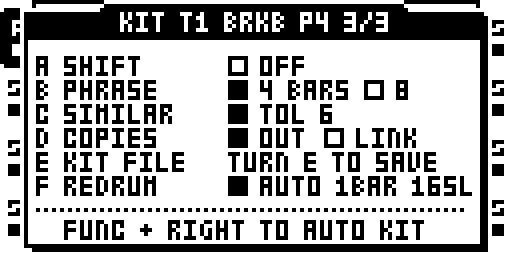

3. **Hear the loop itself.** CONFIG: HUMN 0. LIVE: SEED 0, CPLX 64,
   DENS 64, BRK 0, GHST 0, ORN 0. **PLAY**: your loop, slice by slice, as it
   was played, now following the project's tempo.
4. **Re-drum it.** CONFIG: HUMN 64, ALT 60: now and then a snare is
   another snare, a kick another kick. LIVE: turn SEED: hits move, drop
   out, appear, always the loop's sounds.
5. **Thin and thicken.** CPLX 0: the loop without its ghosts and soft
   hits, a stripped break. CPLX 127 with STYL HOUS: the loop plus house
   hats on the steps it leaves free. DENS 30: a sparse version.
6. **Fills and breaks.** STYL picks the fills' colour (ROCK, FUNK,
   JUNG...). FILLS: TRIP 6LET for sextuplet fills. Put BRK 56 on a scene
   for a bar of fill on the crossfader, BRK 110 for stutters; a fill lands
   on a crash.
7. **Feel.** VEL 60 brings dynamics back on the beats; GHST 40 adds ghost
   notes the original never had.
8. **Back to the source.** HUMN 0, SEED 0, CPLX 64: the original loop
   again. REDRUM is a setting per track, saved with the project; OFF gives
   the style back.

## Reference

How each part works, what was measured and what is open: the details behind
the guide, image by image.

### Use, in detail

1. FUNC + SRC, the machine list: **DRUMMER** is the last row, below PICKUP
   (scroll down: the list shows five rows; double-tapping the track key, then
   LEFT, shows all six). **RIGHT** on DRUMMER's row opens the sample list
   (FLEX's slots, titled `<<FLEX`: a DRUMMER track plays from FLEX's pool),
   **YES** puts the sample on the track and makes it a DRUMMER track, LEFT goes
   back to the machines. YES on the row alone keeps the track's sample.
   Slice the sample in the audio editor (grid, transients, by hand — any
   slicing; DRUMMER reads the slices, it never moves them).
2. The first time, DRUMMER asks: **YES** makes a kit from the slices' sound
   (AUTO), **NO** leaves it empty. Without a kit only the track's own trigs
   play.
3. Another sample picked later (DRUMMER's RIGHT, closing the SETUP window):
   DRUMMER asks again, **YES** AUTO on the new slices, **NO** keeps the kit.
   A Part or bank whose track has another sample never asks.
4. PLAY.

| page | A | B | C | D | E | F |
|---|---|---|---|---|---|---|
| LIVE (SRC) | SEED | DENS | CPLX | ORN | BRK | GHST |
| CONFIG (FUNC + SRC) | STYL | VEL | ALT | SWNG | HUMN | VAR |

Since image 61 (the user's: the style is set once, the seed and the ornaments
are played live); before, STYL and HUMN were on LIVE, SEED and ORN on CONFIG. A
track saved before keeps its bytes: its STYL and SEED values trade places, so
do HUMN and ORN.

STYL (128 positions, a run of them a style, the name shown): BRKB breakbeat, HHOP hip-hop, FUNK, HOUS house, JUNG jungle, DUB one drop, AFRO afrobeat, CLAV son clave 3-2, BOSS bossa, BMBE bembe 12/8, ROCK, DISC disco, TECH techno, TRAP, RNB r&b / neo-soul, DEMB reggaeton dembow, SAMB samba, BAIA baiao, CUMB cumbia, GARA uk garage, DSTP dubstep, SHUF blues shuffle 12/8, SIX8 6/8 afro, ELEC electro, DEEP deep house, MINI minimal techno, AMAP amapiano, FTWK footwork, HILF highlife. Bells, claves, rims and shakers play the kit's PERC slices, congas and the log drum its TOM slices. Each style is written at three levels, BASIC, STANDARD and COMPLEX: CPLX goes from one to the next (0, 64, 127), bringing the next level's hits in one at a time, in an order fixed per style (shown BAS, STD, CPX on the levels and, in between, the level below and how far the next one has come in: B>50 half-way to STANDARD, S>25 a quarter of the way to COMPLEX; image 66); DENS thins the pattern below 64 and adds the complex level's hits by chance above it (`styles.py` is the written source).

**KIT BALANCE: SRC again on the LIVE page** (PAGES; a DRUMMER track's selection
already shows its SRC page, so one press opens it, the next closes it; the
double press still opens CONFIG). The KIT BALANCE window shows the zones' mix, one row a zone (its name, a bar, a short value; image 67, before it six cells of percentages), A-F turn it:
**A KICK, B SNARE** (its ghosts too), **C HATS** (HAT C, HAT O), **D CYMB**
(RIDE, CRASH), **E TOMS, F PERC**. 100 % is the style as written; below, the
zone's hits drop out (OUT at 0 %); above, it plays more: the cells the
style's other levels have, then past ~155 % any step for the light zones
(hats, perc, ghosts) and the 8ths for the others, 198 % at the top. The bar's
middle tick is the style as written (`=`); left of it `-20` takes a fifth of
the zone's hits out, `OUT` all of them; right of it `+40` adds two fifths of
the other levels' hits; past the small tick (the bar dotted) free steps come in
too. A detent is 5 % and a turn stops once on the middle. The
track's own trigs always play. KIT BALANCE lives in the Part (the track's STATIC
PLAYBACK bytes, unused on a FLEX track; seeded at 100 % the first time it
opens), saved and reloaded with it; it takes no lock, LFO or scene. Without
PAGES in the remix there is no KIT BALANCE (the engine plays every zone at 100 %).

**The fill library (image 72).** ORN also sends a share of the fills to a
library (none at 0, 32 % at 16, 90 % from 45; image 72: 20 % at 16, 90 % from
72); each style's colour
(`styles.py` FILL_COLOUR) draws the family, per fill, on SEED, the bar and the
style:
- the style's written fill;
- a rudiment played round the kit, the right hand on the toms (their slices in
  slice order, from the first to the last across the fill), the left on the
  snare, or everything on the snare (accents out, the rest soft), or the hands
  swapped: single, double, paradiddle (RLRR LRLL), inverted paradiddle (RLLR
  LRRL), paradiddle-diddle, six-stroke, double paradiddle, linear fills with
  the kick;
- a triplet fill, the 6/8 feel: 8th triplets (three a beat, at 0, +1/3 and
  -1/3 of a step), sextuplets (six a beat, each pair a hit and its retrig 2/3
  of a step later on the same drum), or 8th triplets breaking into sextuplets
  on the last beat; in 12/8 the grid's triplets, doubled;
- 3 over 4: groups of three 16ths across the beats (of two in 12/8).
Rock, funk, breakbeat and jungle lean to rudiments and triplets alike (image
73: funk had one triplet fill in fifty, a third of its fills now from ORN 40);
afro, shuffle, 6/8, bembe and highlife to triplets; house, techno, minimal and deep house keep mostly
their written fill. A library fill starts on a beat; its accents stand out
(120 against 70, 46 on the snare alone) and ORN puts no flam, ruff or doubled
hit on it, only its closing roll (image 73). ORN 0: the written fills only,
as before.

**Fills on BRK (image 75).** BRK in its fill zone, 32..63 (the crossfader,
a scene), closes every bar with a fill, as long as BRK's place says: half a
beat at 32, a beat from 40, two from 48, a bar from 56 (FILLS' LONG
overrides). VAR places its own as before (the phrase's end; past half longer
ones; near the top most bars' end) while FILLS' FREQ is AUTO; FREQ BRK keeps
the fills for BRK alone (none heard unless asked), 2BAR and PHRS too, on
those bars.

**The landing (image 76).** A fill of a beat or more (VAR's, BRK's from 40,
a library fill) lands on a crash, the next bar's 1, accented: a combo slice
holding the crash (and the kick) when the kit has one, else the crash alone
over the kick; the hats after it let it ring. The state keeps the last step's
fill, so BRK let go as the fill ends still lands. A whole-bar fill going on
(BRK 56 held) lands when it stops; half a beat (BRK 32) does not land; KIT
BALANCE's CYMB at 0 drops it, and a kit with no crash plays its 1 as before.

**REDRUM (image 77): the sample's own loop as the groove.** The KIT
window's page 3, F, per track (drummer.work, version 5). Off, the style's
groove as before. On, each slice of the sample is placed where its hit falls
in the loop (its start plus its ALIGN, the trim being TRIM_BARS long, else the
slot's tempo's, at most 8 bars; its place off the 16th kept, 1/24 step) and
that loop is the groove: HUMN 0, SEED 0, CPLX 64 replay it as it is, each
step its own slice at its own level. The knobs then bend it: ALT (x HUMN)
swaps a slice now and then for another of its zone (the redrum), SEED moves,
empties and fills cells, VAR changes bars, DENS thins it, GHST adds ghosts,
BRK fills, chops and repeats it, a fill lands on the crash. CPLX: 0 the loop
without its soft slices and ghosts, 64 the loop, 127 the loop and the style's
COMPLEX cells on the steps it leaves free (its own hits never lose to them).
The style gives its fills (its written fill, its colour; a 12/8 style's bar is
16 steps here, ROCK's fill written), not its lay-back nor swing: the loop has
its own. A slice OUT of the kit (SIMILAR's copies, OUT) still plays on its
step, raw: KIT BALANCE and SEED do not reach it (SIMILAR LINK keeps its zone).
No slice: REDRUM plays the style as off.

**REDRUM's LOOP (image 78).** F turns OFF, AUTO, then 1, 2, 4 or 8 BARS. AUTO
reads TRIM_BARS (else the slot's tempo) and lays the loop on the nearest of
1, 2, 4, 8 whole bars: a slot that never had its own tempo takes the project's,
and a 150 BPM loop of 12.8 s read 6.4 bars at 120 (102 steps, off the bar:
image 77 played it so). A number of bars forces it, whatever the slot's
attributes say. The row shows what REDRUM laid: `AUTO 8BAR 32SL`,
`4 BARS 32 SL`, `NO SLICES`. A trim holding no whole slice (left unset) gives
way to the slices' own extent. The byte is image 77's: its ON reads AUTO.

**FILLS (image 74): the fills set by hand, live.** SRC once more on a
DRUMMER track (LIVE, then KIT BALANCE, then FILLS, then LIVE again) shows six
rows, A-F, each a choice, AUTO first (VAR, ORN and the style decide, as
above):

| | knob | choices |
| --- | --- | --- |
| A | FILL | AUTO, WRIT (the style's written fill), RUDI, TRIP, 3:4: the family of every fill |
| B | FREQ | AUTO (BRK 32..63's at every bar, and VAR's own), BRK (BRK's alone: no fill without it), 2BAR, PHRS (BRK's alone, every 2nd bar, the phrase's end) |
| C | LONG | AUTO (BRK's place: 32 half a beat, 40 one, 48 two, 56 a bar), 1BT, 2BT, BAR |
| D | STIK | AUTO, else one sticking of the family set in A (`--` under AUTO or WRIT) |
| E | ORCH | AUTO, TOMS (right hand round the toms, left on the snare), SNR (all on the snare), SWAP |
| F | TRIP | AUTO, 8TH (8th triplets), 6LET (sextuplets), 8>6 (8ths into sextuplets on the last beat); set under FILL AUTO, the fills are triplets (image 78: it was heard only under FILL TRIP) |

The stickings (D): rudiments SNGL single, DBLE double, PARA paradiddle, INVP
inverted paradiddle, PDDL paradiddle-diddle, SIXS six-stroke, DPAR double
paradiddle, LIN3 / LIN4 linear with the kick, FTAP flam tap, DRAG single
drag tap, RTMQ ratamacue, FIVE five-stroke roll; triplets TRPL single-stroke,
RLL, SIXS six-stroke, PDDL paradiddle-diddle, LIN linear, SWIS Swiss army
triplet, FACC flam accent; 3:4 TSS (tom snare snare), LIN, KSS (kick snare
snare), FSS (flam snare snare). A flam is the accent and its retrig 3/24 of
a step later, a drag's double a retrig 6/24 later. The six bytes live in the
Part (NEIGHBOR's SETUP column of the track, unused on FLEX, marked 'F' after
KIT BALANCE's 'M'): each Part has its own, a Part change brings its fills.
Turned while the pattern plays, the next fill takes them.

**Every style plays the whole kit.** Each style has a PERC and a TOM part from
STANDARD up (written per genre in `styles.py`'s LAYER: shakers in house,
cowbell and perc 16ths in funk, rim and toms in techno ...), and its fill
ends on toms (on the snare with no TOM in the kit). TOM and PERC win a step
over HAT C and RIDE (they lose to the kick, the snare, the crash and HAT O):
the closed hats give way. A zone the kit does not have plays the nearest one
it has, so a kit of KICK, SNARE and HAT C alone plays every style:

| zone | played by, in order, when the kit lacks it |
|---|---|
| KICK | TOM, PERC |
| SNARE | GHOST, PERC, TOM |
| GHOST | SNARE (soft), PERC |
| HAT C | HAT O, RIDE, PERC |
| HAT O | HAT C, RIDE, CRASH |
| RIDE | HAT C, HAT O, PERC |
| CRASH | HAT O, RIDE, HAT C |
| TOM | PERC, SNARE |
| PERC | TOM, HAT C, RIDE |

With a RIDE in the kit and a style that writes none, the closed hats move to
the ride every other phrase (HUMN and VAR past 32). Kits saved before image
58 with the old default priority get the new one.

LIVE's knobs take locks, LFOs and scenes; an LFO's PMTR on the SRC page names DRUMMER's knobs (SRC SEED, ...: image 63, FLEX's PTCH STRT before), and the bottom bar reads SRC > DRUMMER. BRK: 0 the groove; 1-31 more of
the style's second layer; 32-63 a fill at every bar's end, half a beat at 32, a beat from 40, two from 48, a bar from 56 (image 75; 2 to 5 steps before);
64-95 slices drawn from the whole kit (80-95 half-time); 96-127 cuts per
beat (a repeat, or a hole: since image 78 a repeated beat stutters on all its
steps, the empty ones too, and a hole is one acting beat in six, never the 1
nor two beats running; past 112 the stutter is tighter). BRK back to 0 is the groove again, and the same
SEED replays the same performance from the transport start.

GHST is its own knob since image 65 (HUMN 64's level, HUMN 0 no longer mutes it): soft snares on free steps near the backbeat, the GHOST zone or a soft SNARE, scaled by KIT BALANCE's SNARE.

CONFIG's knobs are the humanisation, scaled by HUMN (64: as set, 127: twice
as far; HUMN 0 plays the groove untouched):

| knob | 0 | towards 127 |
|---|---|---|
| SEED | the style's own table (shown `TBL`) | eight bands of sixteen, shown band:variant (`1:01` at 1 .. `8:15` at 127): the band is how far from the table (12 % of the cells touched in band 1, 18, 25, 32, 39, 46, 53, 60 % in band 8: emptied, filled or moved by a 16th or an 8th; the kick on 1 and the snares on 2 and 4 kept), the place in the band the variant. A variant is the same in every band, harder in each (a cell it touches in a band it touches the same way above), and keeps its feel: the ghosts, the humanisation, the fills and BRK's draws follow the variant alone (image 62) |
| VEL | every hit as loud | beats loud, off-16ths soft (hats most), chance; past half, random full accents |
| ALT | always the first slice of a role | another slice of the role; past half any role of the zone; near the top a neighbour's sound (KICK/TOM, SNARE/GHOST, HAT C/HAT O/RIDE) |
| SWNG | straight | laid-back snare, swung hats; past half every off-16th shuffles, up to a third of a step, looser |
| ORN | none | its own knob since image 64, HUMN does not scale it (HUMN 0 no longer mutes it): flams on loud snares and rolls closing fills from 1 (32 % of the loud snares at 32, 64 % at 64, all from 100), ruffs into 2 and 4 from 49, hats, ride and perc doubled from 76, tripled from 111; each ornament's spacing drawn from three, tight to open (image 68: flams 2, 3 or 4 24ths of a step apart, ruffs 3, 4, 6, rolls 4, 6, 8, doubled 6, 8, 12, tripled 4, 6, 8), the hits ornamented the same |
| VAR | none | fills at the phrase's end; past half the groove changes from bar to bar (up to a third of the cells) and the fills grow (two beats, now and then a whole bar); near the top a fill at every bar's end. FILLS' FREQ BRK, 2BAR or PHRS: no VAR fill, BRK's alone (image 75) |

A trig on the track always plays (an accent; on an empty step a kick on the
beat, else a snare).

#### The KIT window

Hold a trig key and press **BANK** on a DRUMMER track (any mode; BANK alone still selects a bank). One row a
slice, on three pages: **LEFT** / **RIGHT** go from one to the next (the header shows 1/3, 2/3, 3/3). The
footer reminds **FUNC + RIGHT TO AUTO KIT** on every page.

| control | page 1: SL ZONE ROLE LNK | page 2: SL ALGN GAIN SCN DOSE | page 3: the track, AUTO KIT |
|---|---|---|---|
| A | ZONE | ALIGN, 0-250 ms: the slice starts that much early, so a hit inside it lands on the step (at most a step) | SHIFT on / off: a light hit (ghost, hats, perc) that loses a collision moves to the next free step |
| B | ROLE | GAIN, -24 to +6 dB: the slice's level, on top of the hit's velocity (heard); applied to the hit's VOL value (VOL's own dB law is not measured); a LINKED slice turns its whole group | PHRASE 4 / 8 bars (VAR's fills and crashes) |
| C | | | SIMILAR: AUTO's tolerance, OFF or 1-15 (6 by default) |
| D | | | COPIES: what AUTO does with the similar slices, OUT or LINK |
| E | | SCENE, -- or 1-16: the Part's scene played on this slice's hits | KIT FILE: turned, SAVE KIT FILE? (YES writes NAME.drk beside the sample) |
| F | | DOSE, 5-100 %: how far towards the scene's values | REDRUM: OFF, AUTO, 1 2 4 8 BARS (images 77-78, below) |

| control | does |
|---|---|
| UP / DOWN | the slice before / after, heard |
| a trig key | that slice of the cursor's sixteen, heard |
| FUNC + RIGHT | AUTO again (asked first: YES replaces the kit, puts every GAIN back to 0 dB and every ALIGN to the hit AUTO finds, 0 for most slices; NO keeps it) |
| YES / NO | close |

Page 3 draws each setting as switches (a filled box is the one on). SIMILAR
and COPIES act at the next AUTO. LNK shows `=n` on every slice of a group of
similar slices, n the one AUTO kept.

**SCENE.** A slice with a scene plays, on each of its hits and on this track
only, the scene's locks of the track: LFO, AMP, FX1 and FX2 (not PLAYBACK:
those are DRUMMER's knobs), DOSE of the way from the Part's value, as locks on
the hit's trig. The next hit puts the Part's values back, or plays its own
slice's scene. Set the scene as any scene (SCENE A or B held, a knob); keep a
few scenes for the slices (9-16, say) and the others for the crossfader. A
lock the trig has of its own wins; the crossfader's morph comes after the
locks, so a scene on the fader moving the same knob has the last word. FX2's
DELAY on SEND is a send per slice (its repeats ring on); a reverb's MIX on a
scene is cut by the next hit that has none.

**The kit file** (image 68). Page 3's E saves the kit beside its sample:
`AUDIO/LOOP.wav` gets `AUDIO/LOOP.drk` (the slot's path with its extension
swapped). It holds what the sound decides: zones, roles, combos, priority,
ALIGN, GAIN, the SIMILAR groups, tolerance and mode, and the slices it was
made on (their count and a CRC-32 of their bounds). SCENE, DOSE, SHIFT and
PHRASE stay in the project. When a DRUMMER track has no kit yet, or gets
another sample, DRUMMER first looks for the sample's `.drk`: found and its
slices unchanged, the kit loads (toast KIT FILE LOADED) and nothing is asked;
the slices changed since (resliced), the AUTO question says ITS KIT FILE IS OUT
OF DATE; no file, the question as before. The engine task reads and writes the
file: the KIT posts a job (type 0x42) on its queue, the way BRAIN posts its
(0x41), and DRUMMER takes it at the queue's receive (`0x40084854`, just before
BRAIN's switch detour at `0x4008485e`, so the two compose). A sample renamed
outside the unit leaves its `.drk` behind (rename both).

A Part or bank change that gives a DRUMMER track another sample (image 70;
any track, shown or not) never asks anything, a set may be playing: the
track's kit is put aside (one per track, with its sample) and the new
sample's `.drk` is loaded if it fits (toast KIT FILE LOADED); with no file,
or an out-of-date one, the kit stays (toast NO KIT FILE on the shown track).
Back on the sample put aside, its kit returns as it was left, edits included
and no file read: two Parts in turn each keep their kit. The kit put aside
lives in RAM only (a project load clears it); SAVE KIT keeps it for good.
Image 71: a sample picked in SETUP puts the old sample's kit aside too (image
70 dropped it, so a Part made in SETUP on another sample lost the first Part's
kit), and its kit file is the Part's sample's, not the one still playing.
Two patterns on the same Part and the same sample share one kit: the kit is
the sample's.

**The kit maker** (`kitmaker.py`, on the computer). A folder of one-shots
becomes one sliced sample with its kit, ready to copy to the card's `AUDIO`
folder:

    .venv/bin/python3 modules/drummer/kitmaker.py MY_SOUNDS/ OUT/MYKIT

writes `MYKIT.wav` (the sounds end to end, 44.1 kHz; 24 bit and stereo when
an input is; ffmpeg converts other rates and formats), `MYKIT.ot` (one slice
per sound, no timestretch, no loop) and `MYKIT.drk`. Each sound's zone comes
from its sub-folder (`KICK/`, `SNARE/`, `HATC/`...), else a word of its name
(kick/bd, snare/sd/clap, ghost, hh/closed, oh/open, ride, crash, tom,
perc/shaker/rim...), else AUTO (`autokit.c`, the KIT's own analysis); its
role from a word (accent/hard, soft/light), else by level inside its zone;
slices sorted by zone. `--dry-run` prints the kit and writes nothing.
It also takes one WAV holding every sound (`kitmaker.py CHAIN.wav OUT/NAME
[--names kick,snare,hh,...]`): the slices of the `.ot` beside it (the WAV and
the `.ot` then copied unchanged, only the `.drk` new), else `--grid N` equal
slices, else the WAV's cue points (scaled to 44.1 kHz), else a cut at each
silence (by default -84 dB for 50 ms: a chain's gaps of near zeros, so a
decay's dip is no cut; -50 dB when the file has no such gap); the file's order kept, zones from
`--names` in order, else AUTO. A loop with no silence and no `.ot` needs
`--grid` (or slicing on the unit first). `--preview DIR` writes each slice as `NN_ZONE.wav` to listen to before
naming them (AUTO gets 30 of the 35 sounds of the user's acoustic kit since
image 69: a cut crash, a long open hat, a soft ride and a rim shot want names). The
`.drk` matches because the firmware's `.ot` reader (`0x4008b8d0`, read
8 Nov 2026) copies the file's 64 slices x 12 bytes to the slot's record +312
unchanged, the bounds `drk_sig` hashes; it refuses a wrong checksum (the
16-bit sum of bytes 20..829).

The kits are saved per project in `drummer.work` (and `drummer.strd`):
version 4 since image 59 (SIMILAR: the groups, the tolerance and the mode per
track), version 3 since image 55 (SCENE and DOSE), version 2 since image 53 (GAIN);
an older file loads with what it lacks at 0 (no scene, GAIN 0 dB, no group,
SIMILAR at 6 OUT).

#### AUTO

Per slice: its main hit (the first 1 ms at half its peak) and, over 70 ms
from it, how much is low (a ~110 Hz low-pass), how much is high (the first
difference) and how much it holds; and how long it rings (its last 10 ms
within 40 dB of the peak, 4 s at most). KICK lows ≥ 45 %; CRASH or RIDE a ring
of 1.2 s or more with lows < 15 % and highs ≥ 5 % (CRASH if it holds ≥ 60 %);
HAT highs ≥ 15 % and lows < 15 % (HAT O if it holds); SNARE some highs and
lows < 30 %, GHOST the same soft; TOM lows ≥ 15 %; else PERC.

Image 69: the low-pass computes in 1/256 (in whole units it stood still on a
quiet kick: -8 dBFS read 29 % lows for 97 %), the ring and the cymbal rule
are new, HAT starts at 15 % highs (25 before). `score_autokit.py` scores AUTO
on `autokit_refs.py`, samples the user named on their disk (never committed):
the 16-slice loop 10/10 (as before), a 35-sound acoustic kit 30/35 (11 before).
Calibrated on those two only: another kit may want other thresholds. Roles by level inside each zone. ALIGN from
a hit 15 ms or later into its slice. A proposal to correct in the window.

**SIMILAR** (image 59). Each slice also gets a fingerprint that leaves its
level out: the share of its energy in four bands (one-poles at ~110 Hz,
~0.9 kHz and ~3.5 kHz) and its envelope over the 70 ms in eight segments.
Inside each zone, loudest first, a slice within the tolerance of one already
kept is its copy: OUT, or LINKED to it (GAIN turned on one turns the group). Every AUTO puts the GAINs back to 0 dB.
A copy 6 dB softer or more is kept instead, as a SOFT. The toast says how many
(`8 SIMILAR OUT`). The scale, measured on the host: the user's 16-slice loop
(two bars, the second repeating the first) has its repeats 0.1-5.7 apart and
keeps 8 slices at 6; a 32-sound kit chain's two nearest sounds are 6.7 apart.

### Measured

Under the ColdFire port only — **never run on a unit yet**. The investigation
and every address: [INVESTIGATION.md](INVESTIGATION.md).

- `verify.py`: the engine's rules on the host (HUMAN 0 untouched, SEED, the
  track's trigs, BRK back to 0, collisions, SHIFT, bounds) and its ColdFire
  compile.
- `verify_port.py`: the user's loop on a DRUMMER track, 2 bars at 240 BPM;
  every voice start matched to its step and compared with the engine for
  the same kit and knobs: groove, human, forced, config, align — 32/32 each,
  on every track (T1-T8); ALIGN 20 ms starts 880 samples early (882); rolls
  (ORN, BRK cuts): the hits in the engine's order, their retrigs stock's;
  gain: GAIN -12 dB on every slice, each hit's VOL the groove's x 0.25;
  live: SLICES trig mode with the AED open, trigs 3/6/10/1 play slices
  3/6/10/1 as on a FLEX track (a live start takes stock's slice, not the engine's).
- `verify.py`: a KICK / SNARE / HAT C kit plays every style (70 % of a full
  kit's hits or more, every bar); a full kit plays all nine zones across the
  styles.
- `verify_live2.py` (MKII): SRC again opens KIT BALANCE on a DRUMMER track, A and C
  write the Part, SRC again or AMP closes it, the double press opens SRC
  SETUP, FUNC opens nothing, a FLEX track gets nothing; TRIG 1 + BANK opens
  the KIT, BANK alone does not.
- `verify_port.py --case mix`: HIP-HOP with KIT BALANCE KICK 0 %, HATS 198 % in the
  Part: 32/32 steps as the engine says (no kick, 26 hats). `verify.py`: KIT BALANCE
  at 100 % changes nothing, KICK 0 / 50 / 100 / 198 % more kicks each time,
  all at 0 % only the track's trigs.
- `verify_port.py --case scene`: slice 5 on scene 1 (FX1's first knob 100),
  slice 3 the same at DOSE 50 %: at every start the lane's knob is 100, 50,
  or the Part's on the other slices (22/22).
- The sample from DRUMMER's row: RIGHT, a slot, YES keeps the track DRUMMER
  with the new slot; a plain FLEX track's pick unchanged (port, screens).
- `verify_store.py`: a kit edited on the panel (GAIN, SCENE and DOSE included), SAVE PROJECT,
  drummer.work and .strd on the card (CRC-32), a boot on that card puts the kit back.
- `verify_autokit.py`: AUTO on the host against the hand analysis of the
  loop, SIMILAR at 6 (OUT keeps slices 3 4 5 8 9 10 15 16, LINK groups the
  same 8 copies), and the firmware's AUTO (the question, YES) equal to the
  host's in both modes (`--tol 6 [--mode link] --port`), GAIN -2 on a linked
  slice turning its group.
- `verify_drk.py` (image 68): SAVE KIT on the panel writes `AUDIO/DRUMMER_TEST.drk`
  (DRKT v1, 468 bytes, its CRC-32, the kit as the panel left it, the slices'
  count and CRC); on that card a track with no kit takes the file's kit
  without a question (slice 1 KICK in drummer.work, SNARE in the file: SNARE);
  with slice 1's start moved the file is refused and AUTO asks.
- `verify_kitmaker.py`: synthesized one-shots (a folder, names, one unnamed,
  48 kHz 24-bit and stereo inputs; then one WAV: cut at silences with
  `--names`, cue points at 48 kHz, its `.ot` kept byte for byte, `--grid`) through `kitmaker.py`: the WAV, the `.ot`
  (its checksum, one slice per sound end to end), the `.drk` (its CRC, the
  `.ot`'s slice count and CRC), the zones and roles the names say and AUTO's
  for the unnamed; under the port, the project's slices = the `.ot`'s and a
  track with no kit takes the file's kit without a question. Image 70: Part 1
  on one kit, Part 2 on another (slot 2), the Part index poked as a Part
  change sets it: the second `.drk` loads and the first kit goes aside; back
  on Part 1 its kit returns with an edit made before; with no second `.drk`
  the kit stays and nothing is asked. Image 71: Part 2's sample picked in
  SETUP (the new-sample job, case 2) puts Part 1's edited kit aside (image 70:
  nothing aside, the test fails on it). 🟡 The Part change is the poked index,
  not the panel's. 🟡 The port's
  project carries the slices (as verify_port's does); the unit loading the
  `.ot` itself from the browser is read in the code, not run.
- `shots_ui.py`, `shots_kit.py`: the machine row, both pages, the KIT window.

### Open

- Played on the author's MKII (images 52-78): the hits' VOL, the
  micro-timing, AUTO, REDRUM heard as intended. Not measured on a unit: the
  CPU of AUTO on 64 slices (image 69 adds the ring: up to 4 s a slice read
  at every 4th frame).
- The track's scale is learnt from a trig of its own (1X until one plays).
- The trig LEDs do not show the zones yet.
- Standalone on the machine list: conflicts with ANALOG BD, OCTA303 and
  CX OSC (row 5, and CX OSC's FLEX start) until DRUMMER joins HOOKS'
  machine_rows.
- STORE client 8 (after CHORDS FACTORY 7): renumbered when merged beside other
  clients.
