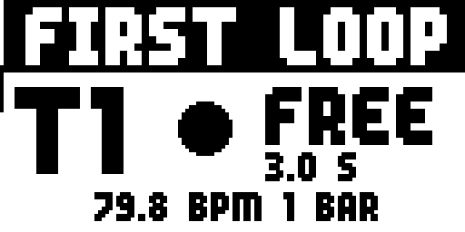
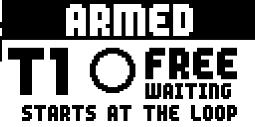
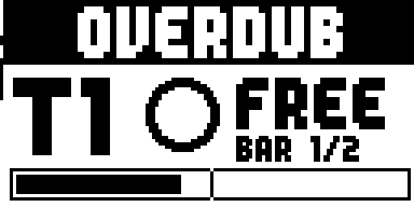
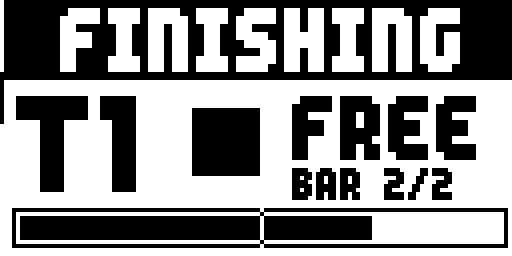
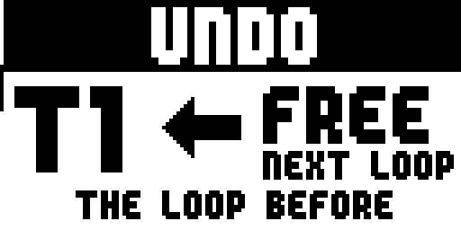
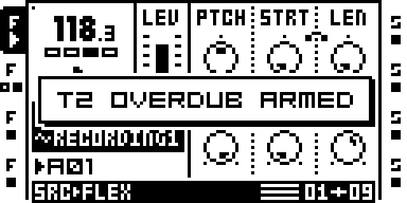
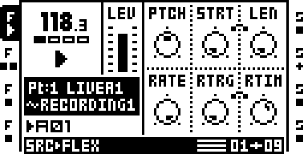
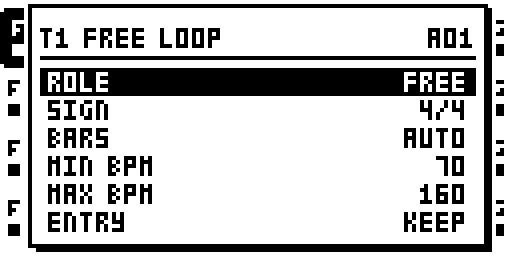
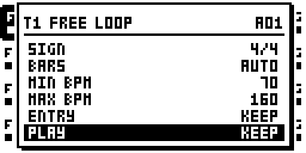
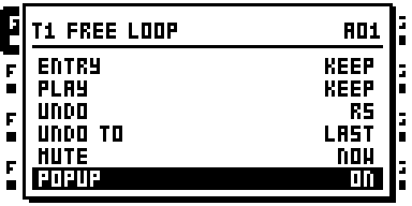

# `free-loop` — FREE LOOP

Auteur : [djib](https://github.com/Djibdjib). La marque de piste reprend la
forme des anciennes icônes d'état de REC_TRIG_MUTE (Zac-Kyoti/octatrack-kyoti-fw,
MIT) ; freeloop.work via [STORE](../store/README.md) ; à côté de REC_TRIG_MUTE
et de REC THRESHOLD via [HOOKS](../hooks/README.md) (sambanks).

**Sommaire :** [Ce que fait le module](#ce-que-fait-le-module) · [Ce qu'il faut](#ce-quil-faut) ·
[Démarrage rapide](#démarrage-rapide) · [Les pédales](#les-pédales) ·
[Le popup REC](#le-popup-rec) · [La marque de la piste](#la-marque-de-la-piste) ·
[La fenêtre](#la-fenêtre--track--up) · [Comment le tempo est choisi](#comment-le-tempo-est-choisi) ·
[Configurations](#configurations) · [Tuto 1 : ta première boucle](#tuto-1--ta-première-boucle) ·
[Tuto 2 : un morceau en trois parties](#tuto-2--un-morceau-en-trois-parties) ·
[English version](README.md)

Les écrans sont capturés sur l'émulateur (`tools/site/capture_manual.py free-loop`,
sur le projet de `make_template.py`). La référence technique (chaque cas,
les sites du firmware, les garde-fous, les mesures) est dans la
[version anglaise](README.md#reference).

## Ce que fait le module

FREE LOOP fait de l'Octatrack un **looper qui se joue au pied**, les mains
sur une guitare, un synthé ou un micro. Chaque piste en boucle a ses propres
pédales, sur son canal MIDI :

- **REC** (CC 90). Séquenceur arrêté et rien d'enregistré : le premier appui
  lance une **prise libre**, le second la termine. Tu joues la longueur de
  la boucle au feeling, sans clic ni décompte. À la fin, FREE LOOP choisit
  le **tempo** qui en fait un nombre entier de mesures, règle la longueur du
  pattern et **lance le séquenceur**, la boucle sur le pas 1. Ensuite, REC
  **arme un overdub**, qui démarre au prochain début de boucle, et le
  **coupe**.
- **PLAY/STOP** (CC 91) : lance, coupe et rétablit le son de la boucle.
- **UNDO** (CC 92) : retire le dernier overdub, et le remet (REDO).
- **END** (CC 93) : arrête la boucle à sa fin, ou la fait revenir à son
  prochain début.

Quelques CC de plus, sur le canal PROG CH, pilotent toute la machine : PLAY
/ STOP, vider tous les enregistreurs, pattern suivant / précédent, banque
suivante / précédente. Une fenêtre par piste (**TRACK + UP**) règle son rôle,
sa mesure, sa plage de tempo, sa façon d'entrer dans chaque pattern, son
buffer d'UNDO et le grand popup REC.

Une piste laissée sur OFF, le réglage par défaut, reste d'origine. Sur un
Octatrack d'origine, un projet fait avec FREE LOOP s'ouvre avec de simples
pistes FLEX et leurs enregistrements.

## Où le trouver

FREE LOOP est dans le remix de test `free-loop`. Il a besoin de :

- **STORE** : les réglages sont sauvés avec le projet, dans `freeloop.work`.
- **RLEN PLEN** : le RECORDING SETUP d'une piste a RLEN = PLEN, si bien qu'un
  overdub dure exactement une boucle, la longueur fixée par la prise libre.

Il partage une image avec REC_TRIG_MUTE et REC THRESHOLD : HOOKS, ajouté par
la build, les relie aux endroits qu'ils partagent. Il ne peut pas partager
une image avec MORPH, qui utilise le même TRACK + UP.

## Ce qu'il faut

- **Un pédalier MIDI** qui envoie un CC de valeur 127 à l'appui et 0 au
  relâchement (pédale *momentanée*). Les appuis longs (1 s) sont chronométrés
  par FREE LOOP et ont besoin du relâchement. Une pédale qui n'envoie que 127
  marche pour les appuis courts, mais ne fait jamais d'appui long. L'auteur
  utilise un XSONIC Airstep.
- **Le canal MIDI de la piste.** Les pédales d'une piste s'envoient sur le
  canal de cette piste (MIDI CONTROL : par défaut T1 sur le canal 1 ... T8
  sur le canal 8). AUDIO CC IN n'est pas nécessaire. Les CC de transport vont
  sur le canal **PROG CH** (PROG CH RECEIVE activé). Sur le canal AUTO, les
  CC 90-93 agissent sur la piste sélectionnée.
- **Un projet préparé pour la boucle.** `modules/free-loop/make_template.py`
  en écrit un, prêt à jouer. La suite de ce guide l'utilise.

## Démarrage rapide

1. **Fabrique le projet modèle** avec l'image que tu fais tourner :
   `python3 modules/free-loop/make_template.py --image out/mainos_bus.bin`
   écrit `out/templates/FREE_LOOP`. Copie-le dans un set de la carte et
   charge-le. Ce qu'il contient :
   - **T1** boucle de guitare (FREE) et **T2** couche de guitare (GRID), sur
     les entrées A B.
   - **T3** boucle de synthé (FREE) et **T4** couche de synthé (GRID), sur
     les entrées C D.
   - T1-T4 sont des pistes FLEX, chacune sur son propre buffer
     d'enregistrement (R1-R4), avec R5-R8 comme buffers d'UNDO.
   - **T5-T8** sont laissées libres pour tes samples.
   - Les entrées s'entendent par DIR AB / DIR CD dans le mixer.
   - Chaque piste enregistre l'entrée par-dessus elle-même (sound on sound)
     avec RLEN = PLEN.
2. **Règle ta pédale** sur CC 90, canal 1, momentanée (127 / 0). C'est le
   REC de T1.
3. **Joue.** Séquenceur arrêté : appuie sur REC et joue ta phrase. Le popup
   REC remplit l'écran : FIRST LOOP, les secondes prises, et le tempo et les
   mesures que donnerait la prise si tu la terminais maintenant.

   

4. Appuie de nouveau sur REC **sur le premier temps**, là où la boucle
   revient. Le tempo est réglé, le pattern prend la longueur de la boucle et
   le séquenceur démarre : ta boucle tourne.
5. Appuie encore sur REC : la piste est **ARMED**. Au prochain début de
   boucle, elle enregistre l'entrée par-dessus la boucle (**OVERDUB**),
   passe après passe, jusqu'au prochain appui sur REC.

## Les pédales

Sur le canal de la piste :

| pédale | appui court | tenue 1 s |
|---|---|---|
| **REC** (CC 90) | arrêté, rien d'enregistré : lance / termine la prise libre ; ensuite : arme / coupe l'overdub | piste qui joue : UNDO ; piste coupée ou séquenceur arrêté : **vide la boucle** |
| **PLAY/STOP** (CC 91) | arrêté : PLAY ; en lecture : coupe / rétablit (MUTE NOW) ou END (MUTE END) | END |
| **UNDO** (CC 92) | UNDO, puis REDO ; pendant une passe : abandonne la passe | -- |
| **END** (CC 93) | entendue : coupe à la fin de la boucle ; coupée : revient au prochain début ; de nouveau : annule | -- |

Sur le canal PROG CH :

| CC | action |
|---|---|
| 83 | PLAY / STOP du séquenceur |
| 84 | séquenceur arrêté : vide R1-R8 (RECORDING CLEARED!) |
| 85 / 86 | pattern suivant / précédent (après A16 vient B01) |
| 88 / 89 | pattern 1 de la banque suivante / précédente |

Les CC 83-89 marchent aussi en mode MIDI, et sur le canal AUTO : tu peux
jouer un synthé depuis une piste MIDI et piloter quand même le transport au
pédalier. Changer de banque pendant que le séquenceur tourne vide R1-R8.

Vider une boucle que tu entends demande deux gestes, pour que ça n'arrive
jamais par accident : coupe-la (PLAY/STOP), puis tiens REC.

## Le popup REC

Avec **POPUP ON** (la dernière ligne de la fenêtre), tout l'écran dit ce
que la piste enregistre, en assez gros pour être lu de l'autre bout de la
pièce. Il s'ouvre quand REC lance une prise ou arme la piste, et se ferme
0,5 s après la fin de la passe. Il ne prend aucune touche ; ouvrir la
fenêtre TRACK + UP le ferme.

| | |
|---|---|
|  | **FIRST LOOP** : la prise libre. Un disque pulse ; dessous, les secondes prises, et le tempo et les mesures que la prise donnerait maintenant. |
|  | **ARMED** : l'overdub attend le début de la boucle (STARTS AT THE LOOP). L'anneau clignote. |
|  | **OVERDUB** : la passe enregistre. BAR n/N et la barre en dessous montrent où tu en es dans la boucle, avec un repère par mesure. |
|  | **FINISHING** : REC a coupé l'overdub ; la passe en cours va jusqu'à la fin de la boucle, puis s'arrête. |
|  | **UNDO** : la boucle d'avant la dernière passe revient au prochain début de boucle (REDO, UNDONE, NO UNDO au même endroit). |

Une passe REPLACE (plus bas) affiche **REPLACE**, avec un disque troué.

## La marque de la piste

Avec POPUP OFF, ou quand le popup est fermé, une piste FREE / GRID montre ce
qu'elle fait à côté de son icône d'état, sur le bord gauche de l'écran :

- **un anneau** qui clignote à 2 Hz quand elle est **armée** ;
- **un point** pendant qu'elle **enregistre un overdub** ;
- le `+` d'origine quand son propre enregistreur tourne hors d'un overdub.

| armée : l'anneau | en overdub : le point |
|---|---|
|  |  |

Ici, la pédale de T2 (CC 90 sur le canal 2) vient de l'armer ; le toast le
confirme. La marque de T2 est à gauche de son icône, la deuxième en partant
du haut.

## La fenêtre : TRACK + UP

Tiens une touche de piste et appuie sur **UP** : la fenêtre de cette piste.
**UP / DOWN** choisissent une ligne, **LEFT / RIGHT** ou n'importe quel
encodeur changent sa valeur, et **YES / NO** (ou de nouveau TRACK + UP) la
ferment. Elle montre six lignes et défile.

| ligne | valeurs | effet |
|---|---|---|
| **ROLE** | OFF, GRID, FREE | OFF : d'origine. GRID : REC arme / coupe des overdubs sur la grille, jamais de prise libre. FREE : comme GRID, et sa première boucle peut être une prise libre qui fixe le tempo. |
| **SIGN** | 4/4, 3/4, 6/8, 5/4, 7/8, 9/8, 12/8, 2/4 | la mesure dans laquelle la prise libre est comptée (16 pas en 4/4, 12 en 3/4 et 6/8, 20 en 5/4, 14 en 7/8...) |
| **BARS** | AUTO, 1, 2, 4, 8, 16 | la longueur de la prise libre en mesures ; AUTO : le moins de mesures dont le tempo tombe dans MIN..MAX |
| **MIN BPM / MAX BPM** | 30..300 | la plage de tempo que la prise libre peut donner (70..160 par défaut) ; AUTO demande un MAX au moins double du MIN |

**ENTRY** et **PLAY** se règlent **par pattern** : l'en-tête nomme le
pattern concerné (A01 ici). Sélectionne un autre pattern et rouvre la
fenêtre pour régler les siens.

| ligne | valeurs | au démarrage de ce pattern |
|---|---|---|
| **ENTRY** | KEEP, ARM, OFF, REPLACE | KEEP : la piste continue comme avant. ARM : elle est armée, et enregistre un overdub dès le premier pas du pattern. OFF : son overdub est coupé. REPLACE : une passe enregistre **les entrées seules** (sans la boucle), comme une nouvelle première boucle à la longueur du nouveau pattern ; la piste est coupée pendant la passe, puis on entend la nouvelle boucle. |
| **PLAY** | KEEP, MUTE, STOP, PLAY | KEEP : comme avant. MUTE : coupée. STOP : ses trigs sont supprimés (les queues d'effets résonnent). PLAY : entendue. |

| ligne | valeurs | effet |
|---|---|---|
| **UNDO** | OFF, R1..R8 (sauf le sien) | le buffer d'UNDO : chaque overdub est enregistré dans l'autre buffer, ce qui permet de retirer le dernier. OFF : les overdubs s'enregistrent sur place, sans UNDO. |
| **UNDO TO** | LAST, 1..16 | LAST : UNDO revient d'une passe. *n* : revient à la boucle telle qu'elle était après son *n*-ième enregistrement (la prise est le 1er) ; les passes suivantes s'enregistrent sur place. |
| **MUTE** | NOW, END | ce que fait l'appui court sur PLAY/STOP quand la piste joue : coupe tout de suite, ou END (à la fin de la boucle) |
| **POPUP** | OFF, ON | le popup REC pour cette piste |

## Comment le tempo est choisi

La prise libre est coupée, jamais étirée ni complétée. FREE LOOP cherche le
tempo le plus lent, au 1/24 de BPM du firmware, auquel les BARS mesures de
la SIGN de la piste ne sont pas plus longues que ce que tu as joué. Avec BARS
AUTO, il essaie 1, 2, 4, 8 et 16 mesures, et garde le moins de mesures dont
le tempo tombe dans MIN..MAX.

Par exemple, en 4/4 avec 70..160, une prise d'environ 4 s donne **2 mesures
à 118,3 BPM**. À 3 s, le popup affichait 79,8 BPM, 1 mesure. Si aucun nombre
de mesures ne tombe dans la plage, la prise est refusée, avec un toast, et
rien n'est écrit. Quand l'Octatrack est esclave d'une horloge MIDI (CLOCK
RECEIVE activé), la prise libre est refusée (EXT CLOCK: NO FREE), parce que
le tempo est celui du maître.

Le pattern prend ensuite la longueur de la boucle : 1X tant qu'elle tient en
64 pas, sinon 1/2X, 1/4X ou 1/8X.

## Configurations

**Un instrument, une boucle.** T1 en FREE, une pédale REC sur le canal 1 et
une pédale PLAY/STOP à côté. Ajoute une pédale UNDO (CC 92) s'il t'en reste
une.

**Guitare et synthé** (le modèle). T1 FREE et T3 FREE : l'instrument qui
commence fixe le tempo, et le premier appui de l'autre arme ensuite un
overdub sur la grille. T2 et T4 sont des couches GRID : une deuxième partie
peut être coupée ou arrêtée sans toucher à la première. Sur l'Airstep de
l'auteur : pédale 3 = REC de la guitare (T1), pédale 4 = REC du synthé (T3).

**Une forme fixe.** Règle BARS sur 4 (ou 8) et une plage MIN..MAX étroite
autour du tempo du morceau. La prise fait toujours ce nombre de mesures,
même si tu la termines un temps trop tôt ou trop tard.

**Mesures impaires.** SIGN 7/8 (14 pas par mesure), 5/4 (20), 12/8 (24) : la
prise est comptée dans ces mesures.

**Un morceau en parties.** Un pattern par partie, avec ENTRY et PLAY réglés
par pattern (Tuto 2), et CC 85 sur une pédale pour passer à la partie
suivante.

**Des arrêts à la mesure près.** MUTE END : l'appui sur PLAY/STOP arrête la
boucle à sa fin, pas à l'appui. END (CC 93) fait la même chose depuis sa
propre pédale, quel que soit le réglage MUTE.

**Plus d'enregistreurs pour les samples.** UNDO OFF sur une piste libère son
buffer d'UNDO. Ses overdubs s'enregistrent alors sur place, sans UNDO.

**Avec REC_TRIG_MUTE.** Le CC 80 et TRACK + NO / YES gardent coupés les
trigs d'enregistrement d'une piste, à côté de FREE LOOP : un trig
d'enregistrement ne part que si FREE LOOP le laisse passer **et** que
REC_TRIG_MUTE n'a pas coupé la piste.

## Tuto 1 : ta première boucle

Le projet modèle, une guitare sur l'entrée A (ou A B), trois pédales sur le
canal 1 : CC 90 (REC), CC 91 (PLAY/STOP), CC 92 (UNDO), toutes
momentanées.

1. **Vérifie la fenêtre de T1.** Tiens T1 et appuie sur UP : ROLE FREE, SIGN
   4/4, BARS AUTO, 70-160 BPM, UNDO R5, POPUP ON. Ferme avec NO.
2. **La prise libre.** Le séquenceur est arrêté. Compte dans ta tête, appuie
   sur REC sur ta première note et joue une phrase. FIRST LOOP est à
   l'écran ; regarde le tempo proposé.
3. **Boucle la phrase.** Appuie sur REC pile là où la phrase revient. Le
   séquenceur démarre et ta phrase tourne en boucle. Le tempo est dans la
   fenêtre TEMPO, et le pattern a la longueur de la boucle.
4. **Le premier overdub.** Appuie sur REC : ARMED. Prépare-toi, l'overdub
   démarre au début de la boucle : OVERDUB, BAR 1/2... Joue une deuxième
   partie par-dessus ; elle s'enregistre passe après passe, chacune sur la
   précédente.
5. **Coupe.** Appuie sur REC : FINISHING. La passe en cours va jusqu'à la
   fin de la boucle et s'arrête ; tu entends la boucle avec tout ce que tu as
   joué.
6. **Annule.** La dernière passe ne te plaît pas ? Appuie sur UNDO : dès le
   prochain début de boucle, la boucle d'avant rejoue. Appuie de nouveau sur
   UNDO (REDO) et la passe revient.
7. **Coupe et rétablis le son.** PLAY/STOP coupe la boucle, un nouvel appui
   la fait revenir. Le fondu évite le clic (avec MUTE MODE OT).
8. **Recommence.** Coupe-la, puis tiens REC 1 s : la boucle est vidée.
   Arrête le séquenceur (CC 83, ou STOP) : comme plus aucune piste n'a de
   boucle, le prochain REC est une nouvelle prise libre, qui fixe un nouveau
   tempo.

Séquenceur arrêté, le CC 84 vide les huit enregistreurs d'un coup.

## Tuto 2 : un morceau en trois parties

Une intro (une boucle de guitare seule), un couplet (une deuxième couche de
guitare ajoutée), un refrain (une nouvelle boucle remplace la première). Le
projet modèle, avec :

- T1 (FREE) et T2 (GRID) sur la guitare ;
- des pédales sur le canal 1 : CC 90 (REC de T1) et CC 91 (PLAY/STOP de T1) ;
- une pédale sur le canal 2 : CC 90 (REC de T2) ;
- une pédale sur le canal PROG CH : CC 85 (pattern suivant).

1. **Prévois les patterns.** A01 est l'intro, A02 le couplet, A03 le
   refrain. Ils doivent être aussi longs que la boucle : une fois que
   l'étape 3 a fixé la longueur de A01, donne la même à A02 et A03 (FUNC +
   PAGE, SCALE SETUP).
2. **Règle les entrées de chaque pattern.** Sélectionne A02, tiens T2,
   appuie sur UP. Descends jusqu'à ENTRY : **ARM** (T2 commence à enregistrer
   au début du couplet). Ferme. Sélectionne A03, ouvre la fenêtre de T1 :
   ENTRY **REPLACE** (le refrain enregistre une nouvelle boucle sur T1). Dans
   la fenêtre de T2 pour A03, PLAY **MUTE** (la couche disparaît pendant le
   refrain). Reviens sur A01 pour commencer.
3. **Intro.** Séquenceur arrêté : REC de T1, joue le riff, REC sur le
   premier temps. L'intro tourne. Ajoute un overdub si tu veux (REC, REC).
4. **Couplet.** Appuie sur la pédale CC 85 : A02 arrive à la fin de A01,
   comme un changement de pattern d'origine. T2 est armée au premier pas du
   couplet et enregistre ta deuxième partie (le point près de son icône) ;
   appuie sur le REC de T2 pour couper quand c'est bon.
5. **Refrain.** De nouveau CC 85 : au premier pas de A03, T1 est coupée et
   enregistre une passe de ta guitare seule (REPLACE). Ensuite on entend la
   nouvelle boucle, et la couche du couplet, T2, est coupée. Comme T1 a un
   buffer d'UNDO, UNDO fait revenir la boucle de l'intro.
6. **Fin.** END (CC 93) sur une piste, ou PLAY/STOP avec MUTE END, l'arrête
   à la fin de sa boucle. Le CC 83 arrête tout.

Chaque pattern garde ses propres ENTRY et PLAY pour chaque piste, et le
projet les sauve (SAVE PROJECT écrit `freeloop.strd`).
