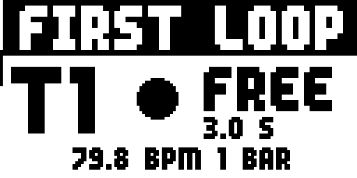
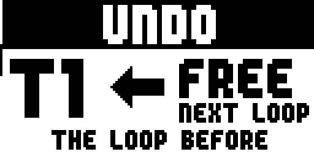
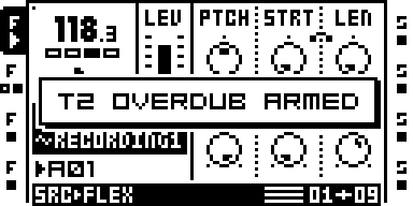
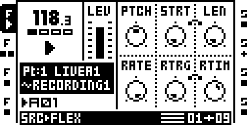
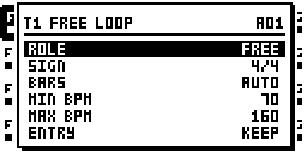
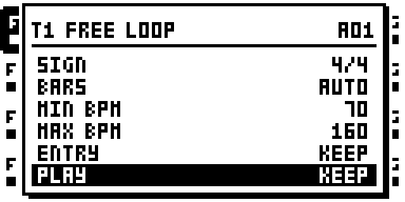
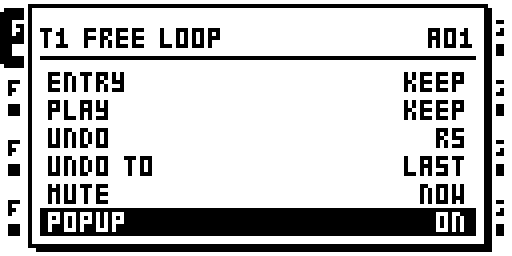

# `free-loop` — FREE LOOP

Author: [djib](https://github.com/Djibdjib). The track mark takes the form of
REC_TRIG_MUTE's former status icons (Zac-Kyoti/octatrack-kyoti-fw, MIT);
freeloop.work through [STORE](../store/README.md); beside REC_TRIG_MUTE and
REC THRESHOLD through [HOOKS](../hooks/README.md) (sambanks).

**Contents:** [What it does](#what-it-does) · [What you need](#what-you-need) ·
[Quick start](#quick-start) · [The pedals](#the-pedals) ·
[The REC popup](#the-rec-popup) · [The track's mark](#the-tracks-mark) ·
[The window](#the-window-track--up) · [How the tempo is chosen](#how-the-tempo-is-chosen) ·
[Configurations](#configurations) · [Tutorial 1: your first loop](#tutorial-1-your-first-loop) ·
[Tutorial 2: a song in three parts](#tutorial-2-a-song-in-three-parts) ·
[Reference](#reference) · [Version française](README.fr.md)

The screens are captured from the emulator (`tools/site/capture_manual.py free-loop`,
on `make_template.py`'s project).

## What it does

FREE LOOP turns the Octatrack into a **looper you play with your feet**,
with your hands on a guitar, a synth or a microphone. Each looping track
gets its own pedals on its MIDI channel:

- **REC** (CC 90). Sequencer stopped, nothing recorded yet: the first press
  starts a **free take**, the second ends it. You play the loop's length as
  you feel it, with no click and no count-in. When it ends, FREE LOOP
  chooses the **tempo** that makes it a whole number of bars, sets the
  pattern's length and **starts the sequencer** with the loop on step 1.
  After that, REC **arms an overdub**, which starts at the next loop start,
  and **cuts** it.
- **PLAY/STOP** (CC 91): plays, mutes and unmutes the loop.
- **UNDO** (CC 92): takes the last overdub back, and brings it back again
  (REDO).
- **END** (CC 93): stops the loop at its end, or brings it back at its next
  start.

A few more CCs, on the PROG CH channel, drive the whole machine: PLAY /
STOP, clear every recorder, next / previous pattern, next / previous bank.
A window per track (**TRACK + UP**) sets its role, its time signature, its
tempo range, how it enters each pattern, its UNDO buffer and the big REC
popup.

A track left OFF, the default, stays stock. On a stock Octatrack, a project
made with FREE LOOP opens with plain FLEX tracks and their recordings.

## Where to find it

FREE LOOP is in the `free-loop` test remix. It needs:

- **STORE**: the settings are saved with the project, in `freeloop.work`.
- **RLEN PLEN**: a track's RECORDING SETUP has RLEN = PLEN, so an overdub is
  exactly one loop long, the length the free take set.

It shares an image with REC_TRIG_MUTE and REC THRESHOLD: HOOKS, added by the
build, joins them at the sites they share. It cannot share an image with
MORPH, which uses the same TRACK + UP.

## What you need

- **A MIDI pedalboard** that sends a CC with value 127 at the press and 0 at
  the release (a *momentary* pedal). The long presses (held 1 s) are timed by
  FREE LOOP and need the release. A pedal that sends 127 only works for
  short presses, but it never long-presses. The author uses an XSONIC
  Airstep.
- **The track's MIDI channel.** A track's pedals are sent on that track's
  channel (MIDI CONTROL: by default T1 on channel 1 ... T8 on channel 8).
  AUDIO CC IN is not needed. The transport CCs go to the **PROG CH** channel
  (PROG CH RECEIVE on). On the AUTO channel, CC 90-93 act on the selected
  track.
- **A project set up for looping.** `modules/free-loop/make_template.py`
  writes one, ready to play. The rest of this guide uses it.

## Quick start

1. **Make the template project** with the image you run:
   `python3 modules/free-loop/make_template.py --image out/mainos_bus.bin`
   writes `out/templates/FREE_LOOP`. Copy it into a set on the card and
   load it. What it holds:
   - **T1** guitar loop (FREE) and **T2** guitar layer (GRID), on inputs A B.
   - **T3** synth loop (FREE) and **T4** synth layer (GRID), on inputs C D.
   - T1-T4 are FLEX tracks, each on its own recorder buffer (R1-R4), with
     R5-R8 as their UNDO buffers.
   - **T5-T8** are left free for your samples.
   - The inputs are heard through the mixer's DIR AB / DIR CD.
   - Every track records the input over itself (sound on sound) with
     RLEN = PLEN.
2. **Set your pedal** to CC 90 on channel 1, momentary (127 / 0). It is T1's
   REC.
3. **Play.** Sequencer stopped: press REC and play your phrase. The REC
   popup fills the screen: FIRST LOOP, the seconds taken, and the tempo and
   bars the take would give if you ended it now.

   

4. Press REC again **on the downbeat**, where the loop comes round. The
   tempo is set, the pattern takes the loop's length and the sequencer
   starts: your loop plays.
5. Press REC again: the track is **ARMED**. At the next loop start it
   records the input over the loop (**OVERDUB**), pass after pass, until you
   press REC again.

## The pedals

On the track's channel:

| pedal | short press | held 1 s |
|---|---|---|
| **REC** (CC 90) | stopped, nothing recorded: start / end the free take; then: arm / cut the overdub | track playing: UNDO; track muted or sequencer stopped: **clear the loop** |
| **PLAY/STOP** (CC 91) | stopped: PLAY; playing: mute / unmute (MUTE NOW) or END (MUTE END) | END |
| **UNDO** (CC 92) | UNDO, then REDO; during a pass: drop the pass | -- |
| **END** (CC 93) | heard: mute at the loop's end; muted: back at the next loop start; again: cancel | -- |

On the PROG CH channel:

| CC | does |
|---|---|
| 83 | sequencer PLAY / STOP |
| 84 | sequencer stopped: clear R1-R8 (RECORDING CLEARED!) |
| 85 / 86 | next / previous pattern (A16 goes on to B01) |
| 88 / 89 | pattern 1 of the next / previous bank |

CC 83-89 work in MIDI mode too, and on the AUTO channel: you can play a
synth from a MIDI track and still drive the transport from the pedalboard.
Changing the playing bank while the sequencer runs clears R1-R8.

Clearing a loop you hear takes two gestures, so that it never happens by
accident: mute it (PLAY/STOP), then hold REC.

## The REC popup

With **POPUP ON** (the window's last row), the whole screen says what the
track is recording, big enough to read from across the room. It opens when
REC starts a take or arms the track, and closes 0.5 s after the pass ends.
It takes no keys; opening the TRACK + UP window closes it.

| | |
|---|---|
|  | **FIRST LOOP**: the free take. A disc pulses; below, the seconds taken and the tempo and bars the take would give now. |
|  | **ARMED**: the overdub waits for the loop start (STARTS AT THE LOOP). The ring blinks. |
|  | **OVERDUB**: the pass records. BAR n/N and a bar under it show where you are in the loop, with a mark per bar. |
|  | **FINISHING**: REC cut the overdub; the pass in progress runs to the loop's end, then stops. |
|  | **UNDO**: the loop before the last pass comes back at the next loop start (REDO, UNDONE, NO UNDO in the same place). |

A REPLACE pass (below) shows **REPLACE**, with a holed disc.

## The track's mark

With POPUP OFF, or while the popup is closed, a FREE / GRID track shows what
it does next to its status icon, at the screen's left edge:

- **a ring** blinking at 2 Hz while it is **armed**;
- **a dot** while it **overdubs**;
- the stock `+` while its own recorder runs outside an overdub.

| armed: the ring | overdubbing: the dot |
|---|---|
|  |  |

Here T2's pedal (CC 90 on channel 2) has armed it; the toast says so. T2's
mark is left of its icon, the second one down.

## The window: TRACK + UP

Hold a track key and press **UP**: that track's window. **UP / DOWN** choose
a row, **LEFT / RIGHT** or any encoder change its value, and **YES / NO**
(or TRACK + UP again) close it. It shows six rows and scrolls.

| row | values | what it does |
|---|---|---|
| **ROLE** | OFF, GRID, FREE | OFF: stock. GRID: REC arms / cuts overdubs on the grid, never a free take. FREE: as GRID, and its first loop can be a free take that sets the tempo. |
| **SIGN** | 4/4, 3/4, 6/8, 5/4, 7/8, 9/8, 12/8, 2/4 | the bar the free take is counted in (16 steps in 4/4, 12 in 3/4 and 6/8, 20 in 5/4, 14 in 7/8...) |
| **BARS** | AUTO, 1, 2, 4, 8, 16 | the free take's length in bars; AUTO: the fewest bars whose tempo falls in MIN..MAX |
| **MIN BPM / MAX BPM** | 30..300 | the tempo range the free take may give (default 70..160); AUTO wants MAX at least twice MIN |

**ENTRY** and **PLAY** are set **per pattern**: the header names the
pattern they apply to (A01 here). Select another pattern and open the
window again to set its own.

| row | values | when that pattern starts |
|---|---|---|
| **ENTRY** | KEEP, ARM, OFF, REPLACE | KEEP: the track goes on as it was. ARM: it is armed, and overdubs from the pattern's first step. OFF: its overdub is cut. REPLACE: one pass records **the inputs alone** (not the loop), as a new first loop of the new pattern's length; the track is muted during it and heard on the new loop after. |
| **PLAY** | KEEP, MUTE, STOP, PLAY | KEEP: as it was. MUTE: muted. STOP: its trigs dropped (the FX tails ring out). PLAY: heard. |

| row | values | what it does |
|---|---|---|
| **UNDO** | OFF, R1..R8 (not its own) | the UNDO buffer: each overdub is recorded into the other buffer, so the last one can be taken back. OFF: overdubs record in place, with no UNDO. |
| **UNDO TO** | LAST, 1..16 | LAST: UNDO goes back one pass. *n*: back to the loop as it was after its *n*-th recording (the take is the 1st); passes after it overdub in place. |
| **MUTE** | NOW, END | what PLAY/STOP's short press does while the track plays: mute at once, or END (at the loop's end) |
| **POPUP** | OFF, ON | the REC popup for this track |

## How the tempo is chosen

The free take is cut, never stretched or padded. FREE LOOP looks for the
slowest tempo, in the firmware's 1/24-BPM steps, at which the track's BARS
of its SIGN are not longer than what you played. With BARS AUTO it tries 1,
2, 4, 8 and 16 bars and keeps the fewest whose tempo falls inside MIN..MAX.

For example, in 4/4 with 70..160, a take of about 4 s gives **2 bars at
118.3 BPM**. At 3 s, the popup was showing 79.8 BPM, 1 bar. If no number of
bars fits the range, the take is refused, with a toast, and nothing is
written. With the Octatrack slaved to MIDI clock (CLOCK RECEIVE on), a free
take is refused (EXT CLOCK: NO FREE), because the tempo is the master's.

The pattern then takes the loop's length: 1X while it fits in 64 steps,
otherwise 1/2X, 1/4X or 1/8X.

## Configurations

**One instrument, one loop.** T1 FREE, a REC pedal on channel 1 and a
PLAY/STOP pedal next to it. Add an UNDO pedal (CC 92) if you have one free.

**Guitar and synth** (the template). T1 FREE and T3 FREE: whichever
instrument starts sets the tempo, and the other's first press then arms an
overdub on the grid. T2 and T4 are GRID layers, so a second part can be
muted or stopped without touching the first. On the author's Airstep:
pedal 3 is the guitar's REC (T1), pedal 4 the synth's (T3).

**A fixed form.** Set BARS to 4 (or 8) and a narrow MIN..MAX around your
song's tempo. The take is always that many bars, even if you end it a beat
early or late.

**Odd meters.** SIGN 7/8 (14 steps a bar), 5/4 (20), 12/8 (24): the take is
counted in those bars.

**A song in parts.** One pattern per part, with ENTRY and PLAY set per
pattern (Tutorial 2), and CC 85 on a pedal to go to the next part.

**Bar-accurate stops.** MUTE END: PLAY/STOP's press stops the loop at its
end, not at the press. END (CC 93) does the same from its own pedal,
whatever MUTE says.

**More recorders for samples.** UNDO OFF on a track frees its UNDO buffer.
Its overdubs then record in place, with no UNDO.

**With REC_TRIG_MUTE.** CC 80 and TRACK + NO / YES keep a track's recorder
trigs muted, beside FREE LOOP: a recorder trig fires only when FREE LOOP
lets it **and** REC_TRIG_MUTE has not muted the track.

## Tutorial 1: your first loop

The template project, a guitar on input A (or A B), three pedals on
channel 1: CC 90 (REC), CC 91 (PLAY/STOP), CC 92 (UNDO), all momentary.

1. **Check T1's window.** Hold T1 and press UP: ROLE FREE, SIGN 4/4, BARS
   AUTO, 70-160 BPM, UNDO R5, POPUP ON. Close with NO.
2. **The free take.** The sequencer is stopped. Count yourself in, press REC
   on your first note and play a phrase. FIRST LOOP is on screen; watch the
   tempo it suggests.
3. **Close the loop.** Press REC exactly where the phrase comes round. The
   sequencer starts and your phrase loops. The tempo is in the TEMPO window,
   and the pattern has the loop's length.
4. **The first overdub.** Press REC: ARMED. Get ready, the overdub starts at
   the loop start: OVERDUB, BAR 1/2... Play a second part over it; it
   records pass after pass, each one over the last.
5. **Cut.** Press REC: FINISHING. The pass in progress runs to the loop's
   end and stops; you hear the loop with everything you played.
6. **Undo.** Not happy with the last pass? Press UNDO: from the next loop
   start, the loop before it plays again. Press UNDO again (REDO) and the
   pass is back.
7. **Mute and unmute.** PLAY/STOP mutes the loop, and pressing it again
   brings it back. The fade avoids the click (with MUTE MODE OT).
8. **Start over.** Mute it, then hold REC 1 s: the loop is cleared. Stop the
   sequencer (CC 83, or STOP): with no loop left on any track, the next REC
   is a new free take, which sets a new tempo.

With the sequencer stopped, CC 84 clears all eight recorders at once.

## Tutorial 2: a song in three parts

An intro (a guitar loop alone), a verse (a second guitar layer added), a
chorus (a new loop replaces the first). The template project, with:

- T1 (FREE) and T2 (GRID) on the guitar;
- pedals on channel 1: CC 90 (T1 REC) and CC 91 (T1 PLAY/STOP);
- a pedal on channel 2: CC 90 (T2 REC);
- a pedal on the PROG CH channel: CC 85 (next pattern).

1. **Plan the patterns.** A01 is the intro, A02 the verse, A03 the chorus.
   They must be as long as the loop: once step 3 has set A01's length, set
   A02 and A03 to the same (FUNC + PAGE, SCALE SETUP).
2. **Set each pattern's entries.** Select A02, hold T2, press UP. Go down to
   ENTRY: **ARM** (T2 starts recording when the verse starts). Close. Select
   A03, open T1's window: ENTRY **REPLACE** (the chorus records a new T1
   loop). In T2's window for A03, PLAY **MUTE** (the layer drops out for the
   chorus). Go back to A01 to start.
3. **Intro.** Sequencer stopped: T1 REC, play the riff, REC on the downbeat.
   The intro loops. Overdub it if you like (REC, REC).
4. **Verse.** Press the CC 85 pedal: A02 comes in at the end of A01, as a
   stock pattern change does. T2 is armed at the verse's first step and
   records your second part (the dot by its icon); press T2's REC to cut it
   when it is right.
5. **Chorus.** CC 85 again: at A03's first step, T1 is muted and records
   one pass of your guitar alone (REPLACE). Then the new loop is heard and
   the verse's layer, T2, is muted. Since T1 has an UNDO buffer, UNDO brings
   the intro's loop back.
6. **Ending.** END (CC 93) on a track, or PLAY/STOP with MUTE END, stops it
   at its loop's end. CC 83 stops everything.

Each pattern remembers its own ENTRY and PLAY per track, and the project
saves them (SAVE PROJECT writes `freeloop.strd`).

## Reference

The detail of every gesture, the firmware sites, the guards and what was
measured. The guide above is the short form.

### The pedals, every case

| MIDI | does |
|---|---|
| CC 90 on a track's channel (127 press, 0 release) | that track's REC, by its ROLE (below) |
| CC 91 on a track's channel | that track's PLAY/STOP |
| CC 92 on a track's channel | that track's UNDO / REDO (a track with an UNDO buffer, below) |
| CC 93 on a track's channel | that track's END: mute at its loop's end, or back at its next loop start |
| CC 90-93 on the AUTO channel | the current track's |
| CC 83 (PROG CH channel) | PLAY / STOP |
| CC 84 | with the sequencer stopped: clear R1-R8, "RECORDING CLEARED!" |
| CC 85 / 86 | next / previous pattern (A16 -> B1) |
| CC 88 / 89 | pattern 1 of the next / previous bank |

CC 83-89 are admitted as stock admits a Program Change (PROG CH RECEIVE
on; the PROG CH channel, or the AUTO channel when it is AUTO), except that
the AUTO channel is admitted in MIDI mode too: they drive the transport and
the banks, not a track (stock refuses a Program Change on AUTO in MIDI
mode, `0x40033970`; the user's MKII, 31 Oct 2026: CC 83 did nothing with
MIDI on; scenario `midistop`). A change of
the playing bank while the sequencer runs clears R1-R8.

### A track's pedals

REC (CC 90):

| ROLE | sequencer | press |
|---|---|---|
| FREE | stopped, no loop on any track | a free take on the track's recorder (its RECORDING SETUP's sources, RLEN MAX whatever RLEN says) |
| FREE | the take running | end it: tempo, the playing pattern's length and scale, the loop's end, PLAY |
| FREE / GRID | otherwise, not armed | arm the overdub: the track's next recorder trig fires (after PLAY when stopped), and every one after |
| FREE / GRID | armed or overdubbing | cut: the pass in progress ends, nothing more |
| OFF | | stock |

REC still held 1 s after a press that armed or cut, the pedal still down,
depends on whether the track plays (the sequencer runs and the track is
heard): playing, what the press did is undone, then UNDO as CC 92 (a pass
recording: dropped, OVERDUB UNDONE; no UNDO buffer: NO UNDO BUFFER, nothing
cleared); not playing (muted, or the sequencer stopped), or after a press
that started a free take: the track's loop cleared (a take or a pass in
progress dropped, its recorder stopped first). The press that ends a take
does nothing more. Clearing a heard loop takes two gestures: mute it, then
hold REC.

PLAY/STOP (CC 91), FREE and GRID tracks:

| sequencer | press | still held 1 s after the press |
|---|---|---|
| stopped | PLAY at the press (the track unmuted) | nothing more |
| playing, MUTE NOW | mute / unmute the track at the press (stock's CC 49 on its channel: the screen, the LEDs and MUTE MODES follow) | the press's mute undone, then END (CC 93's) from the state before it: the track was cut, or let through, for that second |
| playing, MUTE END | END at the press | the same END |
| the track's free take running | end it, as REC | -- |

The long press (REC and PLAY/STOP) fires 1 s after the press, the pedal
still down, timed on the unit's DTIM3 count (132 MHz) from the UI tick: a
release (value 0) before then cancels it. The pedal must send 127 at the
press and 0 at the release: one that sends 127 only clears 1 s after each
press (OCTABAM8). The clear is made once the recorders it stops are done
(the stop writes the take's end).

END (CC 93), FREE and GRID tracks:

| sequencer | track | press |
|---|---|---|
| playing | heard | it stops when the pass in progress ends (at the next pass's first step) |
| playing | muted | it comes back at the next pass's first step |
| playing | an END pending | cancelled |
| stopped | | mute / unmute at once |

UNDO (CC 92), a track with an UNDO buffer (the window's UNDO row: another
recorder buffer; the template gives T1-T4 R5-R8):

| the track | press |
|---|---|
| a pass recording | the pass dropped: its recorder stopped, the track stays on the loop it played, the overdub cut; no redo |
| at rest, after a pass | UNDO: the loop before the last pass, from the next loop start |
| after an UNDO | REDO: the last pass back, from the next loop start |
| nothing recorded since the last clear | NOTHING TO UNDO |

With an UNDO buffer an overdub never writes the loop that plays. The track
plays X (say R1); the pass records into the other buffer Y (R5): Y's
recorder, started by the step handler on the same step as the track's own
recorder trig, with the track's RECORDING SETUP (its inputs, SRC3 = the
track itself, RLEN PLEN), so Y = X + the new layer. Once Y's recorder runs,
the track's Flex slot becomes Y (the Part's slot byte in the four Parts of
the bank, RAM and CS1, and the live lane `0x8000082f + 72 t` that a trig
reads), heard from the next loop start; the next pass records into X from
Y, and so on. UNDO / REDO switch the slot back and forth. The buffer's own
track lends its recorder: FREE LOOP keeps that track's RECORDING SETUP equal
to the looping track's in the bank's Parts (stock reads RLEN from the Part,
so a pass with the buffer track's own RLEN MAX never ended). A STOP during a
pass drops that pass (its recorder stopped); the long PLAY/STOP clears X and
Y and puts the track back on its own buffer. Without an UNDO buffer the
overdub records in place, as before.

UNDO TO (the window, per track; LAST by default, the above): with UNDO TO
n, UNDO goes back to the loop as it was after its n-th recording, the take
(or a first pass) being the 1st. The passes ping-pong until that one is
recorded; from then on, each pass from the other buffer overdubs it in
place, so the n-th stays where it is: with UNDO TO 1, a take and four
overdubs, UNDO goes back to the take, REDO to the four overdubs. A pass
started on the n-th records into the other buffer (the latest is gone).
UNDO during an in-place pass stops it and goes back to the n-th (REDO: the
latest, with that pass's start in it); the popup says BACK TO PASS n. The
stop writes the buffer's end and LIMIT at the cut, so the adapter keeps its
end, tempo, bars and LIMIT and writes them again once the recorder is done
(`keep_buffer`; OCTABAM18 had REDO play the cut fragment). A
clear or a REPLACE starts the count anew; UNDO TO changed on a loop whose
n-th is gone behaves as LAST until its new n-th comes.

The toggle is the two stores stock's mute makes (`0x80000008` bit 8 + t and
its CS1 mirror), made from the step handler (the recorder-trig test's
detour) as the track's step counter reaches 1: the handler prepares each
step one step ahead (5,514 samples at 120 under the port), so that call
lands with the pass's first trig (2.8 samples after it, port). The UI tick
then posts CC 49's event (`0x400053d8(0x1a, ...)`) for the screen.

A second track's press during a free take shows TAKE IN PROGRESS. With
CLOCK RECEIVE on (the Octatrack a slave) a free take is refused: EXT
CLOCK: NO FREE. A STOP by any means disarms every track.

#### The tempo of a free take

A bar of the track's SIGN is 16 steps in 4/4, 12 in 3/4 and 6/8, 20 in
5/4, 14 in 7/8, 18 in 9/8, 24 in 12/8, 8 in 2/4; the tempo counts quarter
notes, as the Octatrack's. BARS 1, 2, 4, 8, 16, or AUTO: the smallest of
those whose tempo falls inside MIN BPM..MAX BPM (default 70..160). The
tempo is the slowest one (in the firmware's 1/24 BPM steps) whose recorded
loop is not longer than the take: the take is cut, never padded, by under
1/tempo24 of its length (0.06 % at 70 BPM). The loop length is RLEN PLEN's,
`round(T x 2,646,000 / tempo24)`, so the overdubs (RLEN PLEN) land on it.
The pattern takes N bars: 1X while that fits in 64 steps, else 1/2X, 1/4X,
1/8X.

Stock's own sample tempo arithmetic (the slot sanitiser, `0x40020a94` and
`0x40020a24`) uses the same constant: tempo24 = round(2,540,160 x
bars x 100 / length); FREE LOOP picks the bars and rounds toward the cut.

### The window, every row

Hold a track key and press UP: the track's window. UP / DOWN choose a row,
LEFT / RIGHT or any encoder turn the value, YES / NO (or TRACK + UP again)
close it.

| row | values |
|---|---|
| ROLE | OFF, GRID, FREE |
| SIGN | 4/4, 3/4, 6/8, 5/4, 7/8, 9/8, 12/8, 2/4 |
| BARS | AUTO, 1, 2, 4, 8, 16 |
| MIN BPM / MAX BPM | 30..300, MIN <= MAX |
| ENTRY | KEEP, ARM, OFF, REPLACE: how the track's overdub enters the pattern the window's header names |
| PLAY | KEEP, MUTE, STOP, PLAY: how its sound enters that pattern |
| UNDO | OFF, R1..R8 (not the track's own): the buffer UNDO alternates with |
| UNDO TO | LAST, 1..16: the recording UNDO goes back to |
| MUTE | NOW, END: PLAY/STOP's short press while playing, a mute at the press or END |
| POPUP | OFF, ON: the REC popup for this track |

ENTRY ARM arms the track when its pattern starts to play (a chain, a
Program Change, CC 85, TRACK PATTERNS' global change), OFF cuts it, KEEP
leaves it. REPLACE arms one pass from the pattern's first step that
records the inputs only: SRC3 (the track itself) is dropped from that
pass's recorder trig word (`0x5000` = A B + SRC3 in the template, measured
under the port; `0x1000` A B, `0x2000` C D, `0x4000` SRC3), so the new
loop is what is played during it, as a first loop, of the new pattern's
length. The track is muted (the fade) from that pass's loop start and heard
again, on the new loop, at the next; then it is idle (REC overdubs it as
any loop). With an UNDO buffer the pass goes into the other buffer, so
UNDO brings the old loop back. REC before the pass cuts it; UNDO during it
drops it (the old loop heard from the next loop start); a STOP or a clear
during it unmutes the track. The settings are saved with the project in `freeloop.work`
(copied to `freeloop.strd` at SAVE PROJECT, back at RELOAD), a STORE
client; a project without the file has every track OFF. The window shows
six rows and scrolls.

PLAY applies at the track's first step of the pattern (the step handler,
as END): MUTE mutes it, PLAY makes it heard, STOP leaves it unmuted but
drops its trigs from the pattern's first step on (the record builder's
machine-trig test `0x4009d39e`: a stock empty step, locks, retrigs and
micro-timing included; the trig conditions and the recorder trigs still
run) and releases the sounding note on its AMP envelope (`0x40008f84`), so
the FX tails ring out. A STOPped track comes back with PLAY, or a PLAY/STOP
press (at its next trig).

### The fade

A stock mute ramps the track's gain in 16 samples (0.36 ms; payload A
`P:0x22e`'s `asr #4`, measured under the port), a click on a sustained
loop. With MUTE MODE OT, FREE LOOP's own mutes (PLAY/STOP, END, PLAY) fade:
the track's LEVEL byte (`0x80000c50 + 2t`) to 0, which the ColdFire's own
smoothing (1/16 a frame, `0x4000d6ce`) takes to silence in ~15 ms, the mute
3 UI ticks later, LEVEL back unless it was moved meanwhile; an unmute sets
the smoothed copy (`0x80000c60 + 4t`) to 0 first, the sound rising over
~20-30 ms. At a loop start (END, PLAY) the fade starts with the pass's first
trig. The other MUTE MODEs are left alone: they fade on the AMP envelope or
keep the FX tails, which a post-FX level cut would kill.

### The track's mark, how it is drawn

Beside each FREE / GRID track's status icon at the screen's edge: a dot
while it overdubs (whichever recorder records its pass), a ring blinking at
2 Hz while armed; the stock `+` while its own recorder runs and it is not
overdubbing. The code takes the form of REC_TRIG_MUTE's former status icons
(`rtm_glyph` / `rtm_draw`, Zac-Kyoti/octatrack-kyoti-fw, MIT); REC_TRIG_MUTE's own
mute dots now sit beside the tab's machine letter, so the two marks no longer share a
cell.

### The REC popup, every state

With POPUP ON, the whole screen shows what the track records, big enough
to read from across the room while playing, from the moment REC arms it
or starts a take until the pass is over (then 0.5 s): no keys taken, the
screen underneath back once it closes; the TRACK + UP window closes it.

| state | band (2x) | icon (blinks) | below |
|---|---|---|---|
| the free take | FIRST LOOP | a disc pulsing at 2 Hz | the seconds taken; the tempo and bars the take would give now |
| armed | ARMED | a ring blinking at 2 Hz | WAITING, STARTS AT THE LOOP (REPLACES AT THE LOOP) |
| an overdub pass | OVERDUB | a ring, a disc on each beat's first 16th | BAR n/N; the pass's progress, a mark per bar |
| cut, the pass finishing | FINISHING | a stop square blinking | the same |
| a REPLACE pass | REPLACE | a holed disc, bigger on each beat's first 16th | the same |
| UNDO, REDO (1 s) | UNDO / REDO / UNDONE / NO UNDO | an arrow back / on, a cross, a dash | NEXT LOOP, what comes back |

The track (3x) on the left, its ROLE (2x) on the right. The bold 5x8 font
of the window titles (`0x400ba83a`) drawn k x k a dot; drawn again only
when what it shows changes (at most each 16th, 2 Hz otherwise).

### How

Seven detours and one table pointer, one DRAM unit (`free_loop.s`,
generated by `generate.py` from `freeloop.c`, `adapter.c` and `hooks.s`):

- `0x4000e79c`, the stock CC handler's entry: CC 90-93 and CC 83-89.
- `0x4009d9a4`, the step handler's recorder-trig test: a FREE / GRID
  track's recorder trig fires only when armed; a pass into an UNDO buffer
  is moved to that buffer's track (the same step).
- `0x40006d1a`, the recorder routine's setup pointer: a free take reads its
  track's setup with RLEN MAX; an UNDO buffer's recorder reads the looping
  track's setup.
- `0x40056c28`, the UI task's toast countdown: entry modes, clears, the
  loop's end and its tempo / bars stamp, toasts.
- `0x4009d39e`, the record builder's machine-trig test: a PLAY STOP
  track's trigs dropped.
- `0x4004bee2` / `0x4004c00c`, the track status icon renderer: the mark.
- `0x400d164e`, the [TRACK]-held layer's key table (MORPH's site): a copy
  of stock's with UP added.

#### Conflicts

MORPH opens its morph with the same TRACK + UP; the build refuses the pair
by name (one key, two meanings: not a site a bridge can share).

REC_TRIG_MUTE and REC THRESHOLD share an image with FREE LOOP through
[HOOKS](../hooks/README.md) (1 Nov 2026):
- `status_icon` (`0x4004bee2`): `blink_gate`, then `fl_glyph`, so on a track
  FREE LOOP manages its ring or dot is drawn over the blink.
- `rec_gate` (`0x4009d9a4`), codeless: this detour stays, and the unit,
  assembled with `HK_REC_GATE` (the manifest's `select`), hands on to
  `rtm_gate` where it replayed stock. A recorder trig fires only when FREE
  LOOP lets it and REC_TRIG_MUTE has not muted the track. FREE LOOP alone
  builds the same bytes.
- The icon drawer `0x4004c00c` is FREE LOOP's alone since REC_TRIG_MUTE's
  mute dots moved beside the tab's machine letter (its pin after `553d8d2`).

### Guards

- A track's CCs act on audio tracks only (T1-T8); a MIDI track's channel
  reaches stock.
- ROLE OFF (the default, and every track of a project without
  `freeloop.work`) leaves the track stock: FREE LOOP's tests return the
  stock path.
- A free take with CLOCK RECEIVE on is refused (EXT CLOCK: NO FREE): the
  tempo is the master's.
- A take whose tempo falls outside every BARS in MIN..MAX is refused
  (toast), never written; MIN <= MAX is held by the window (30..300).
- The UNDO row offers R1..R8 but the track's own buffer.
- A `freeloop.work` with the wrong magic, length or CRC is refused through
  STORE (the project loads with every track OFF, STORE asks about the file);
  versions 1-3 are read and upgraded.
- The tempo, mailbox and slot writes go through the stock routines the
  REC keys and the TEMPO window use; the clear waits for the recorders it
  stops.
- A recording FREE LOOP did not start, on a FREE or GRID track, is stopped
  at once (`0x40005178(track, 0x80, 0)`, not at QREC's next step), with the
  toast REC: FREE LOOP ONLY; the popup does not open for it. On a track
  with no loop yet its buffer is cleared. On a track with a loop, the
  recorder writes its slot's end from its start (the take's LIMIT while it
  runs, then the stop's position) and its input from the buffer's frame 0
  until the stop lands: under the port (`verify_free_loop stray`, a stock
  T1 + REC AB at 13 s on an 8 s loop) R1's end went from 352,678 to 536 and
  frames 0-535 (~12 ms) were the input's. So the guard keeps a copy of the
  recorder's end, tempo, bars and LIMIT from its last tick without a
  recording and writes them back once the recorder is done (as UNDO's cut
  does, `keep_tick`): the loop keeps its length and tempo; its first
  ~12 ms (at most a UI tick) are overwritten. FREE LOOP's own starts are
  the free take and the recorder trigs its gate lets through or injects
  (`fl_takes`). On the owner's MKII (5 Nov 2026) the first PLAY after a
  reboot, in MIDI mode, filled R1 with T1 idle (the popup said FINISHING),
  and a double STOP before it prevented it: a QREC start staged at
  `0x800018be` / `0x800018de` (REC_POST's quantized branch) is inferred,
  not measured; the port does not reproduce it. The guard is not a fix at
  the source, which is still open
  (`docs/contributing/FAILURE_MODES.md`). Under the port,
  `REC_POST(T1, 0x9010)` after the load records for the whole run without
  the guard, and is stopped within a tick, R1 empty, with it.

A take starts and ends as the REC keys do (`0x40005178(track, word, 1)`,
start word `(keys + 0x8000) | 0x10`, stop `0x80`); the tempo goes through
`0x4009c708(tempo24)` (project or pattern tempo, the latched copies); the
sequencer starts with stock's MIDI Start handler. The take's length is the
recorder's write position at the press (`0x46c802c8[t]`). After the stop
and its fade-out, stock rewrites the slot's end every frame (`0x400043ba`,
then the sanitiser `0x400994b4`); the UI tick writes L until it has held for
four ticks. [INVESTIGATION.md](INVESTIGATION.md) has the firmware findings.

### Measured

Host (`verify.py`): 219 checks -- the tempo of a take (exact cases, the
30 / 300 BPM limits, AUTO's range, signatures, 16 bars) and a sweep of
1,586 takes from 0.5 s to 60 s in four signatures; the pedal's states, long
presses, entry modes, the window's rows, the toasts. The ColdFire unit
compiles with no outside call but the stock routines listed in
`generate.py`.

Under the ColdFire port (`tools/verify/verify_free_loop.py`, remix
`test/free-loop`, `make_template.py`'s project; first run 26 Oct 2026 on
the owner's rig remix):

- load: `freeloop.work` read at the project load (roles FREE GRID FREE GRID).
- free: T1's pedal at 2 s and 10 s: the start word `0xd010` (A B and SRC3)
  then `0x80`; the take 353,080 samples with its fade-out; tempo24 2881
  (120.04 BPM, 4 bars, from the write position at the press); A1 64 steps
  1X; the transport running 3.4 samples (port clock) after the stop was
  posted; R1's end cut to L = 352,678.
- undo (27 Oct 2026): T1 armed at 11 s, cut at 19 s: the pass from 18 s is
  recorded by T5's recorder (T1's not running), with T1's setup (fl_src),
  T1 plays R1 during it, its slot byte (Part and lane) R5 once T5 records;
  R5 ends at 353,022 (L + the fade-out, as T1's own PLEN pass); at 27 s T1
  plays slot 132 (R5); UNDO at 28 s: lane R1, heard from the pass at 34 s.
- undocut: UNDO at 20 s during the pass: T5's recorder stopped, T1 on R1,
  overdub off.
- entryarm (28 Oct 2026): A02's ENTRY ARM for T2 (CC 85 at 12 s): T2's
  pass runs from A02's first step (the UI tick's pattern change comes
  before the builder's step 1).
- replace (28 Oct 2026): a steady input of peak 16,384; at A02's pass the
  recorder's mixed sources (`0x800062cc`) peak at 32,678 with ENTRY ARM
  (input + T2 through SRC3) and 16,385 with REPLACE (the input alone); T2
  muted during the REPLACE pass, heard and idle after it, on R2.
- undoto (28 Oct 2026): UNDO TO 1: at 27 s R5's recorder overdubs R5 in
  place (T1's own idle, R1 the take); UNDO at 28 s: R5's recorder stopped,
  T1 on R1, the next press a REDO; R5's end, bars and LIMIT as before
  the cut (353,022 / 400 / 352,678; without keep_buffer 88,717 / 100 /
  88,717); REDO at 30 s: T1 on R5, whole; REC at 31 s: R5 overdubbed in place
  again over a whole loop.
- undostep (28 Oct 2026): UNDO TO 1, overdubs one at a time (REC, REC):
  UNDO back on R1, REDO back on R5, whole.

UNDO's firmware path (port, 27 Oct 2026): a trig plays the slot named by
the live lane's byte 31 (`0x8000082f + 72 t`, the sample-lock slot), passed
by the dispatch `0x4000d492` to `0x4000f450(track, slot)`; poking the Part's
slot byte alone changes nothing until a Part apply (`0x4000c05c`,
`0x4000c22a`, `0x400092c2`) copies it to the lane; poking the lane moves the
next trig to that buffer (T1 R1 -> R5, voice +8 = slot 132).

### On the unit

The owner's MKII, images OCTABAM8 to OCTABAM17 (a rig remix carrying FREE
LOOP with octabam's core and TRACK PATTERNS; the same module but for REC
MUTE, which was REC_TRIG_MUTE's and is left out here), 26-28 Oct 2026, an
XSONIC Airstep sending 127 / 0:

- OCTABAM17: PLAY entries, the fades, the track's mark, UNDO / REDO in
  the popup: all as described.
- OCTABAM8: REC (CC 90) works,
  the free take sets the tempo and starts the sequencer. CC 91 on a pedal
  that sends 127 only muted the loop and cleared it about 1 s later: the
  long press then fired while held, timed on UI ticks, and with no
  release the press stayed held. OCTABAM9 decides the clear at the release.
- OCTABAM12 (same unit, 27 Oct 2026): UNDO and REDO work in FREE. With the
  clear decided at the release, the Airstep's own long press had to send
  REC at the release (late); OCTABAM13 times the long press again while
  the pedal is held, on REC too, for an Airstep sending 127 / 0.
- OCTABAM9 (same unit, 26 Oct 2026): T1 FREE, 4/4, BARS 2, 70-100, TSTR
  AUTO, 2 bars played in range: the tempo shown in range, but about half the
  take played over the loop, slower. Not reproduced under the port (the slot
  there carried the new tempo). Read: FLEX stretches by project tempo / the
  slot's tempo (+0x114), which stock stamps from the tempo latched while it
  records; on the unit it evidently kept the take's old tempo. OCTABAM10
  stamps the slot itself with the loop's tempo24 and bars (+0x114, +0x118,
  +0x11c, +0x120) with the end, until they hold.

### Open

- UNDO on the unit: the seam when the track switches buffer, a sample lock
  on the loop's track (the lane is FREE LOOP's while the track has an UNDO
  buffer), SAVE PROJECT while a track plays its UNDO buffer (the Part keeps
  that slot), PART RELOAD (back on the saved slot).

- The delay from the stop to the first step and the seam by ear (`make
  panel`, phase 5).
- The display of a tempo24 between two tenths in the TEMPO window.
- A free take while PATTERN TEMPO is on (`0x4009c708`'s pattern branch).
- The pattern length written outside the editor across SAVE / RELOAD.
- Whether `0x4009c708` and the REC mailbox may run on the MIDI thread
  (they do here, for the timing; the alternative is the UI tick, ~17 ms).
- The status icon blink while armed (REC THRESHOLD's site `0x4004bee2`).
- FREE LOOP beside REC_TRIG_MUTE on the unit: HOOKS since 1 Nov 2026, under
  Unicorn and the port; flashed in the owner's rig remix (live-djib, images
  42 to 79, 5-10 Nov 2026) and played there with FREE LOOP, REC_TRIG_MUTE's
  own gestures beside it not reported separately. `track_key` is not needed:
  REC_TRIG_MUTE's mute moved to the base keymaps' [REC] records at its pin
  553d8d2, so only MORPH wants FREE LOOP's key table.
- On the unit, separately: T2 GRID, every ENTRY mode, ROLE OFF beside
  FREE tracks; this image (without REC MUTE) not flashed.
