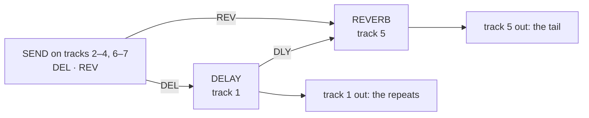

# octabam-bus

A remix of Octatrack OS 1.40C, built from your own copy of it, that adds a
**delay and reverb bus** with a send from every track, three new FX1
effects, ten stock effects on FX1, and the [core modules](../octabam/README.md#the-core-modules)
(KITS, scene and parameter locks on page 2, USB MIDI and USB audio, BRAIN and
the rest) and the extra ColdFire modules of `octabam` (OCTA303, MORPH,
REC THRESHOLD, BUFFER SAVER, COPY PROJECT, EUCLID FILL, TRACK PATTERNS). The USB settings are at their defaults here (TRACKS PRE, MAIN, CUE, MIDI on). See [Where it has run](#where-it-has-run).

## The bus

Every track's FX2 slot takes part in one delay-and-reverb chain. Tracks 1
and 5 host the two engines; every other track has a SEND with two knobs,
DEL and REV, that set how much of the track goes to each. The delay's
repeats also feed the reverb (the reverb's DLY knob). Each engine's wet
signal comes out on the track that hosts it.

> **Tracks 1 and 5 must be THRU tracks with no trigs of their own.** That
> is the only setup the bus has been tested in. Sounds programmed on track
> 1 made the delay pop and click (reported 29 Sep 2026, cause open:
> [FAILURE_MODES.md](../../docs/contributing/FAILURE_MODES.md)). Track
> 5 with a sample machine or trigs has not been tested.



| track | FX2 | knobs |
|---|---|---|
| 1 | **DELAY** (locked) | page 1: DEL · REV · FDBK · TONE · PING · WET; page 2: MODE · SCTR · DENS · SIZE · PTCH · TIME |
| 5 | **REVERB** (locked) | page 1: DEL · REV · SIZE · SHMR · SHFT · WET; page 2: MODE · TONE · DIFF · GATE · DLY · TIME |
| 2–4, 6–7 | **SEND** | DEL · REV |
| 8 (master) | stock **DELAY** | stock's, for its beat repeat |

Modules: [`busdelay`](../../modules/busdelay/README.md),
[`busverb`](../../modules/busverb/README.md), [`send`](../../modules/send/README.md),
[`rig-hosts`](../../modules/rig-hosts/README.md) (a new project is born wired this way),
[`tempo-sync`](../../modules/tempo-sync/README.md) (the delay follows the project tempo),
[`tempo-bus`](../../modules/tempo-bus/README.md) (the TEMPO window edits both engines),
[`fx2-lock`](../../modules/fx2-lock/README.md) (the FX2 chooser cannot change a track's effect).

## FX1

| effect | in place of | modes | module |
|---|---|---|---|
| SPECTRUM | FILTER | LADR · SEM · ISO · VOWL | [`spectrum`](../../modules/spectrum/README.md) |
| CHARACTER | LO-FI | SAT: TAPE · TUBE · INFL | [`character`](../../modules/character/README.md) |
| MODULATION | CHORUS | JUNO · DIM · FLNG · COMB · PHSR | [`modulation`](../../modules/modulation/README.md) |

The FX1 chooser lists NONE and these three. The 13 stock effects not
listed give up their DSP code to the bus.

## What it costs

| | stock | octabam-bus |
|---|---|---|
| sample and recorder memory | 14,602 pages | 12,895 pages (the platform reserve) |
| DSP code in the window | | the servers, SEND, SPECTRUM, CHARACTER, MODULATION and LOAD METER (P:0x35800..0x37c67) |

## Where it has run

Port gates only: `make check REMIX=octabam-bus` and the reach round. The seven extra ColdFire modules have not run beside the bus on a unit. The previous
definition of this remix (servers in internal P, three FX1 effects, nothing else
from the stock set) ran on an MKII (owner report, 16 Oct 2026). The servers and
stations running from the shared window, and the stock effects beside them, have
not run on a unit.

## How to flash

[BUILDING.md](../../docs/guide/BUILDING.md) has every step, from what to
install to the way back to stock. For this remix:

1. **Build.** Pick a build number; it becomes the OS version the unit shows.

   ```bash
   make image REMIX=octabam-bus BUILD=91         # -> out/OCTATRACK_OCTABAM91.bin
   ```

2. **Back up the card.** KITS writes `kits.work` into each project it loads.
3. **Old projects.** For a project made before this remix, on the card:

   ```bash
   python3 tools/hw/ot_project.py host "<card>/<set>/<project>"
   python3 tools/hw/ot_project.py stamp-defaults "<card>/<set>/<project>" octabam-bus
   ```

   `host` wires the delay to track 1, the reverb to track 5 and SEND
   elsewhere. A project made on the unit after the flash needs neither.
4. **Flash from the card** ([BUILDING.md section 5](../../docs/guide/BUILDING.md#5-flash-from-the-card)),
   then power-cycle once more. SYSTEM STATUS → OS VERSION reads `OCTABAM91`.
5. **Back to stock:** [BUILDING.md section 8](../../docs/guide/BUILDING.md#8-back-to-stock-or-another-remix).

If the unit misbehaves, [FAILURE_MODES.md](../../docs/contributing/FAILURE_MODES.md)
is the register of what has gone wrong and why.
